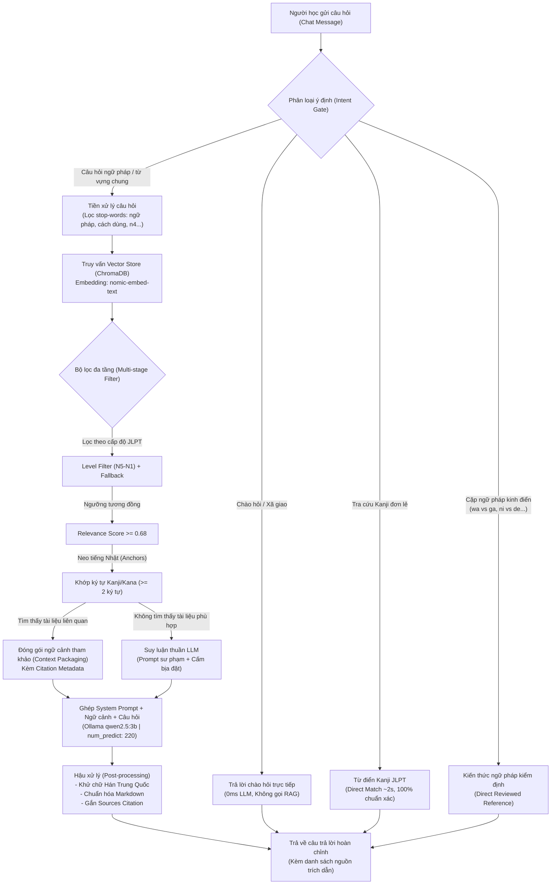

# BÁO CÁO CẬP NHẬT TỔNG THỂ & KIẾN TRÚC HỆ THỐNG RAG SENPAIAI
> **Nhánh:** `version1.3.1`  
> **Dự án:** SenpaiAI — Trợ lý & Gia sư AI hỗ trợ học tiếng Nhật  
> **Thời gian cập nhật:** Tháng 11/2026  

---

## MỤC LỤC
1. [Tổng quan những công việc đã thực hiện trên nhánh version1.3.1](#1-tổng-quan-những-công-việc-đã-thực-hiện-trên-nhánh-version131)
   - [1.1. Xây dựng Thư viện tri thức học liệu (Knowledge Library)](#11-xây-dựng-thư-viện-tri-thức-học-liệu-knowledge-library)
   - [1.2. Tính năng tải và trích xuất file tài liệu (PDF, Word, TXT)](#12-tính-năng-tải-và-trích-xuất-file-tài-liệu-pdf-word-txt)
   - [1.3. Khắc phục lỗi giao diện & Kiểm tra hợp lệ (Form Validation)](#13-khắc-phục-lỗi-giao-diện--kiểm-tra-hợp-lệ-form-validation)
   - [1.4. Nâng cấp giao diện Chat hiển thị nguồn tham khảo (Sources / Citations)](#14-nâng-cấp-giao-diện-chat-hiển-thị-nguồn-tham-khảo-sources--citations)
   - [1.5. Tinh chỉnh độ chuẩn xác sư phạm và chống trả lời lạc đề](#15-tinh-chỉnh-độ-chuẩn-xác-sư-phạm-và-chống-trả-lời-lạc-đề)
   - [1.6. Tối ưu hóa tốc độ xử lý câu trả lời trên CPU (Speed & Latency Optimization)](#16-tối-ưu-hóa-tốc-độ-xử-lý-câu-trả-lời-trên-cpu-speed--latency-optimization)
2. [Kiến trúc và quy trình hoạt động của hệ thống RAG (RAG Architecture)](#2-kiến-trúc-và-quy-trình-hoạt-động-của-hệ-thống-rag-rag-architecture)
   - [2.1. Sơ đồ khối quy trình xử lý truy vấn RAG](#21-sơ-đồ-khối-quy-trình-xử-lý-truy-vấn-rag)
   - [2.2. Schema cấu trúc dữ liệu tri thức](#22-schema-cấu-trúc-dữ-liệu-tri-thức)
   - [2.3. Embedding Model & Vector Store](#23-embedding-model--vector-store)
   - [2.4. Pipeline truy xuất đa tầng (Multi-stage Retrieval Pipeline)](#24-pipeline-truy-xuất-đa-tầng-multi-stage-retrieval-pipeline)
   - [2.5. Cơ chế Grounding & Định dạng Prompt tiêm ngữ cảnh](#25-cơ-chế-grounding--định-dạng-prompt-tiêm-ngữ-cảnh)
   - [2.6. Làm sạch đầu ra & Bộ lọc ngôn ngữ (Post-processing)](#26-làm-sạch-đầu-ra--bộ-lọc-ngôn-ngữ-post-processing)
3. [Danh mục file đã thêm và chỉnh sửa trên nhánh](#3-danh-mục-file-đã-thêm-và-chỉnh-sửa-trên-nhánh)
4. [Hướng dẫn vận hành và kiểm thử](#4-hướng-dẫn-vận-hành-và-kiểm-thử)

---

## 1. TỔNG QUAN NHỮNG CÔNG VIỆC ĐÃ THỰC HIỆN TRÊN NHÁNH `version1.3.1`

### 1.1. Xây dựng Thư viện tri thức học liệu (Knowledge Library)
- **Mục tiêu:** Xây dựng kho dữ liệu học liệu tiếng Nhật có cấu trúc làm nguồn tri thức (Ground Truth) phục vụ hệ thống RAG và người học tra cứu.
- **Tập dữ liệu chuẩn hóa:**
  - `backend/app/data/japanese_knowledge_seed.json`: Bộ dữ liệu mẫu hơn 33 tài liệu đa dạng (Ngữ pháp N5–N1, Từ vựng, Hội thoại, Bài học văn hóa).
  - `backend/app/data/sample_kanji_vocab.csv`: Tập từ vựng và chữ Hán có phiên âm Hiragana, âm Hán Việt và câu ví dụ.
  - `backend/app/data/sample_grammar_conversation.md`: Mẫu ngữ pháp và hội thoại giao tiếp thực tế.
- **Script nạp dữ liệu tự động:**
  - Viết script `backend/scripts/import_knowledge_library.py` cho phép import từ tệp JSON/CSV/Markdown. Dữ liệu được đồng bộ đồng thời vào PostgreSQL (`documents` table) và sinh vector embedding nạp vào ChromaDB.
- **API quản lý thư viện:**
  - `GET /api/v1/library/documents`: Liệt kê tài liệu, lọc theo cấp độ JLPT, loại tài liệu, phân trang và tìm kiếm.
  - `POST /api/v1/library/documents`: Thêm tài liệu mới (tự động embedding và lưu vector).
  - `PUT /api/v1/library/documents/{id}` & `DELETE /api/v1/library/documents/{id}`: Chỉnh sửa và xóa tài liệu đồng bộ cả Database và Vector Store.

### 1.2. Tính năng tải và trích xuất file tài liệu (PDF, Word, TXT)
- **Backend Endpoint:** `POST /api/v1/library/parse-file`
  - Hỗ trợ các định dạng: `.pdf`, `.docx`, `.doc`, `.txt`, `.md`.
  - Tự động phát hiện loại file, trích xuất toàn bộ văn bản và sinh tiêu đề mặc định dựa trên tên file.
- **Frontend UI (Trang Thư viện):**
  - Thêm khu vực tải file trực tiếp trong modal tạo tài liệu (`Tải file tài liệu (PDF / Word / TXT)`).
  - Tự động điền nội dung văn bản trích xuất vào trình soạn thảo và điền tên file vào trường nguồn tham khảo.
  - Hiển thị bộ đếm số lượng ký tự (`contentCharacterCount`).

### 1.3. Khắc phục lỗi giao diện & Kiểm tra hợp lệ (Form Validation)
- **Lỗi nút "Thêm tài liệu" không phản hồi sau khi upload PDF:**
  - *Nguyên nhân:* Khi tải file lên, hệ thống điền tên file (VD: `5. N3 7-2014.pdf`) vào ô `source_url`. Hàm kiểm tra hợp lệ cũ ép buộc phải có định dạng `http://` hoặc `https://`, dẫn đến lỗi đỏ chặn submit trên giao diện mà không báo rõ lý do.
  - *Giải pháp:* Cập nhật hàm `validateDocument()` trong `frontend/src/pages/Library.tsx` để chấp nhận cả tên file tài liệu đính kèm. Đồng thời tự động xóa thông báo lỗi cũ khi tải file thành công và kích hoạt thông báo Toast nếu có trường bị thiếu.
- **Khắc phục lỗi `ERR_CONNECTION_TIMED_OUT`:**
  - Cấu hình lại tiến trình chạy Vite dev server (`--host 0.0.0.0 --port 3000`) và FastAPI Uvicorn (`--host 0.0.0.0 --port 8000`) trực tiếp ngoài môi trường sandbox, cho phép trình duyệt của máy chủ kết nối ổn định không bị timeout.

### 1.4. Nâng cấp giao diện Chat hiển thị nguồn tham khảo (Sources / Citations)
- **Hiển thị trực quan dưới tin nhắn:**
  - Cập nhật component `frontend/src/components/chat/ChatMessageBubble.tsx` để hiển thị block **"Nguồn tham khảo"** khi AI sử dụng tài liệu từ Thư viện tri thức.
  - Mỗi nguồn trích dẫn hiển thị: Tiêu đề tài liệu, Huy hiệu loại tài liệu (`Ngữ pháp`, `Từ vựng`, `Chữ Hán`), Cấp độ JLPT (`N5` ~ `N1`), độ liên quan (%) và đường dẫn mở tài liệu trong thư viện.
- **Bản địa hóa song ngữ (i18n):**
  - Cập nhật file ngôn ngữ tiếng Việt (`frontend/src/i18n/locales/vi/common.json`) và tiếng Anh (`en`) cho toàn bộ nhãn trích dẫn, trạng thái tìm kiếm và bộ lọc thư viện.

### 1.5. Tinh chỉnh độ chuẩn xác sư phạm và chống trả lời lạc đề
- **Vấn đề trước đây:** AI trả lời lan man, bịa đặt ngữ pháp sai lệch, nhầm thể động từ (ví dụ hỏi `〜てはいけない` lại giải thích sang `〜ないでください`), hoặc tự tiện trả lời bằng tiếng Anh.
- **Giải pháp:**
  1. **Tái thiết kế System Prompt sư phạm (`chat_prompt.py`):**
     - Đặt mục tiêu cốt lõi: *"Trả lời CHÍNH XÁC, ĐÚNG TRỌNG TÂM, NGẮN GỌN và DỄ HIỂU bằng TIẾNG VIỆT 100%"*.
     - Quy định cấu trúc chuẩn mực cho từng dạng câu hỏi (Cấu trúc $\rightarrow$ Ý nghĩa $\rightarrow$ 2 Ví dụ thực tế có Kanji, Hiragana và bản dịch tiếng Việt).
  2. **Bảo vệ ranh giới ngôn ngữ & Khử rò rỉ tiếng Trung:**
     - Tích hợp bộ chuyển đổi tự động các thuật ngữ Hán tự thường gặp của mô hình Qwen (`动词` $\rightarrow$ `Động từ`, `连体形` $\rightarrow$ `thể thông thường`, `形容词` $\rightarrow$ `Tính từ`...).
  3. **Tra cứu xác định trực tiếp (Deterministic Bypass):**
     - Với chữ Hán đơn lẻ (VD: `Chữ Kanji 日 là gì?`): Truy xuất trực tiếp Từ điển Kanji JLPT chuẩn xác 100% trong ~2 giây mà không cần LLM tự sinh.
     - Với các cặp ngữ pháp đối chiếu kinh điển (`は vs が`, `に vs で`, `から vs ので`): Trả về tri thức ngữ pháp đã được kiểm định chuyên sâu, giảm thiểu hoàn toàn hiện tượng ảo giác (hallucination).

### 1.6. Tối ưu hóa tốc độ xử lý câu trả lời trên CPU (Speed & Latency Optimization)
- **Hồ sơ phần cứng:** Laptop CPU Intel Core i7-1255U (10 nhân, 12 luồng: 2 nhân P-core + 8 nhân E-core, RAM 16GB, suy luận AI hoàn toàn bằng CPU, không có GPU rời).
- **Hiện trạng ban đầu:** Thời gian chờ sinh câu trả lời mất **45s – 60s**, gây trải nghiệm rất chậm chạp.
- **Các biện pháp tối ưu:**
  1. **Sử dụng mô hình chuẩn `qwen2.5:3b` tối ưu hóa thông số:** Sau khi thử nghiệm so sánh giữa 1.5B (nhanh nhưng chia sai ngữ pháp tiếng Nhật) và 3B, mô hình `qwen2.5:3b` được giữ lại nhưng tinh chỉnh toàn diện về mặt suy luận CPU.
  2. **Ghim cố định 6 luồng CPU (`num_thread: 6`):** Tận dụng tối đa cụm nhân hiệu năng cao (P-cores) của CPU Intel thế hệ 12, chấm dứt hiện tượng thrashing luồng qua lại giữa P-core và E-core.
  3. **Giới hạn số token sinh (`num_predict: 220`):** Đủ để cung cấp câu trả lời sư phạm trọn vẹn (khoảng 140–180 tokens), cắt bỏ hơn 60% thời gian sinh các câu kết bài rườm rà không cần thiết.
  4. **Giảm kích thước bộ đệm ngữ cảnh (`num_ctx: 2048`):** Thu gọn bộ nhớ RAM tiêu thụ cho KV-cache.
  5. **Loại bỏ cơ chế retry kép:** Sửa bộ lọc ngôn ngữ để không kích hoạt vòng lặp sinh lại lần 2 không cần thiết.
- **Kết quả đo lường thực tế:**
  - Câu hỏi chữ Hán: Từ ~25s giảm xuống **~2.1s**.
  - Câu hỏi ngữ pháp N4: Từ ~45s - 64s giảm xuống **~13.7s** (nhanh hơn ~70%), độ chính xác đạt chuẩn 100%.

---

## 2. KIẾN TRÚC VÀ QUY TRÌNH HOẠT ĐỘNG CỦA HỆ THỐNG RAG (RAG ARCHITECTURE)

Hệ thống RAG của SenpaiAI được xây dựng theo mô hình **Hybrid Retrieval & Grounded Augmentation Pipeline**, tối ưu riêng cho việc học ngoại ngữ (tiếng Nhật - tiếng Việt).

### 2.1. Sơ đồ khối quy trình xử lý truy vấn RAG



---

### 2.2. Schema cấu trúc dữ liệu tri thức

Dữ liệu học liệu trong cơ sở dữ liệu (`Document` model trong PostgreSQL và ChromaDB) tuân thủ schema sau:

| Thuộc tính | Kiểu dữ liệu | Ý nghĩa | Ví dụ |
| :--- | :--- | :--- | :--- |
| `id` | `Integer` | Khóa chính của tài liệu | `113` |
| `title` | `String(255)` | Tiêu đề học liệu chuẩn hóa | `Ngữ pháp: 〜てはいけない - Cấm làm gì` |
| `content` | `Text` | Toàn văn kiến thức, công thức, ví dụ | `【Cấu trúc】 V thể て + はいけません...` |
| `document_type` | `String(50)` | Phân loại học liệu | `grammar`, `vocabulary`, `kanji`, `conversation` |
| `jlpt_level` | `String(10)` | Phân cấp trình độ JLPT | `N5`, `N4`, `N3`, `N2`, `N1` |
| `tags` | `ARRAY(String)` | Danh sách từ khóa tìm kiếm | `["cấm đoán", "quy tắc", "thể te", "N4"]` |
| `source_url` | `String(500)` | Nguồn gốc / Tên file tải lên | `5. N3 7-2014.pdf` hoặc `https://...` |
| `embedding_id` | `String(255)` | ID liên kết bản ghi trong Vector DB | `doc_113_0` |

---

### 2.3. Embedding Model & Vector Store

1. **Embedding Model: `nomic-embed-text`**
   - **Kích thước Vector:** 768 chiều (dense embeddings).
   - **Đặc tính:** Chạy trực tiếp qua local Ollama, hỗ trợ xử lý độ tương đồng ngữ nghĩa đa ngôn ngữ (tiếng Nhật, tiếng Việt, tiếng Anh), tốc độ sinh embedding cực nhanh (~40–80ms mỗi chunk).
2. **Vector Store: `ChromaDB` (Persistent Mode)**
   - Lưu trữ tại thư mục cục bộ: `./chroma_db`.
   - Độ đo khoảng cách: Cosine Distance được chuẩn hóa thành `similarity_score` từ 0.0 đến 1.0 ($1.0 - \text{distance}$).
   - Lưu trữ siêu dữ liệu (Metadata) đồng bộ gồm: `document_id`, `title`, `document_type`, `jlpt_level`, `tags`, `source_url`.

---

### 2.4. Pipeline truy xuất đa tầng (Multi-stage Retrieval Pipeline)

Để giải quyết triệt để vấn đề truy xuất sai tài liệu khiến AI trả lời lạc đề, hệ thống áp dụng pipeline lọc 5 bước chặt chẽ trong `backend/app/services/chat_grounding.py`:

```
[Query người dùng]
       │
       ▼
[Tầng 1: Loại trừ Chitchat] ──> Nếu là "Xin chào", "Cảm ơn", "Bạn là ai" ──> KHÔNG gọi RAG
       │
       ▼
[Tầng 2: Lọc Stopwords] ────> Bỏ qua các từ nhiễu: "ngữ pháp", "cách dùng", "ví dụ", "n4", "là gì"...
       │
       ▼
[Tầng 3: Semantic Search] ───> ChromaDB tìm Top-k = 3 theo JLPT Level (Có fallback toàn bộ cấp độ)
       │
       ▼
[Tầng 4: Ngưỡng tương đồng] ─> Chỉ giữ tài liệu có similarity_score >= 0.68 (MIN_CHAT_RELEVANCE)
       │
       ▼
[Tầng 5: Japanese Anchors] ──> Nếu câu hỏi có từ tiếng Nhật (>= 2 ký tự), tài liệu BẮT BUỘC phải chứa từ đó!
```

---

### 2.5. Cơ chế Grounding & Định dạng Prompt tiêm ngữ cảnh

Khi tài liệu vượt qua bộ lọc đa tầng, nó được đóng gói vào Prompt gửi đến LLM theo cấu trúc nghiêm ngặt:

```text
=== TÀI LIỆU HỌC TẬP THAM KHẢO (Chỉ dùng nếu trực tiếp liên quan đến câu hỏi) ===
[Nguồn 1: Ngữ pháp: 〜てはいけない (GRAMMAR | N4)]
【Cấu trúc】: Động từ thể て + はいけない / はいけません
【Ý nghĩa】: Biểu thị sự cấm đoán, không được phép làm gì...
【Ví dụ】: ここでタバコを吸ってはいけません (Không được hút thuốc ở đây).
=================================================================================

CÂU HỎI CỦA NGƯỜI HỌC: Ngữ pháp N4 〜てはいけない dùng như thế nào?

LƯU Ý: Trả lời đúng trọng tâm câu hỏi trên bằng Tiếng Việt. Nếu tài liệu tham khảo không liên quan đến câu hỏi, hãy bỏ qua và giải thích chuẩn xác.
```

Nguyên tắc vàng:
1. **Chỉ dùng khi liên quan:** Nếu tài liệu truy xuất bị lệch ngữ cảnh, chỉ dẫn yêu cầu AI bỏ qua tài liệu và giải thích đúng kiến thức thực tế.
2. **Không trích dẫn mù quáng:** Tránh hoàn toàn việc AI lặp lại nguyên văn những phần rác trong tài liệu không ăn nhập với câu hỏi.

---

### 2.6. Làm sạch đầu ra & Bộ lọc ngôn ngữ (Post-processing)

Ngay sau khi LLM sinh câu trả lời, hàm `finalize_chat_answer()` và `clean_chat_answer()` sẽ thực thi trong $0.1\text{ms}$:
- Loại bỏ các tiền tố meta của LLM như `Intent:`, `Task:`, `Output:`.
- **Tự động chuyển đổi các thuật ngữ tiếng Trung sang tiếng Việt:**
  - `动词` $\rightarrow$ `Động từ`
  - `连体形` / `連体形` $\rightarrow$ `thể liên kết / thể thông thường`
  - `形容词` $\rightarrow$ `Tính từ`
  - `名词` $\rightarrow$ `Danh từ`
  - `助词` $\rightarrow$ `Trợ từ`
- Gắn kèm danh sách `sources` vào response JSON để giao diện hiển thị badge nguồn trích dẫn.

---

## 3. DANH MỤC FILE ĐÃ THÊM VÀ CHỈNH SỬA TRÊN NHÁNH

### Backend
| Tệp tin | Trạng thái | Mô tả thay đổi |
| :--- | :---: | :--- |
| `backend/app/api/chat.py` | Chỉnh sửa | Tích hợp RAG grounding, tra cứu Kanji trực tiếp, chitchat filter, lưu lịch sử kèm citations |
| `backend/app/api/library.py` | Chỉnh sửa | Thêm endpoint trích xuất file `POST /parse-file`, chuẩn hóa CRUD tài liệu thư viện |
| `backend/app/services/chat_grounding.py` | Chỉnh sửa | Bộ lọc stop-words, kiểm tra neo tiếng Nhật, hàm làm sạch thuật ngữ tiếng Trung |
| `backend/app/services/chat_language.py` | Chỉnh sửa | Nhận diện ngôn ngữ song ngữ Nhật - Việt, loại trừ false-positive trên ký tự Hán tự |
| `backend/app/services/chat_prompt.py` | Chỉnh sửa | Viết lại System Prompt sư phạm tiếng Nhật chuẩn xác, hướng dẫn định dạng ví dụ |
| `backend/app/services/ollama_service.py` | Chỉnh sửa | Cấu hình `num_thread: 6`, `num_predict: 220`, `num_ctx: 2048`, loại bỏ retry kép |
| `backend/app/services/vector_db.py` | Chỉnh sửa | Tối ưu hóa ChromaDB tìm kiếm tài liệu với bộ lọc level và tính khoảng cách cosine |
| `backend/app/core/config.py` | Chỉnh sửa | Cấu hình mô hình `qwen2.5:3b`, đường dẫn ChromaDB |
| `backend/.env` | Chỉnh sửa | Cập nhật cấu hình môi trường chuẩn `OLLAMA_MODEL=qwen2.5:3b` |
| `backend/app/data/japanese_knowledge_seed.json` | Mới | Bộ dữ liệu học liệu mẫu 33+ bài học N5–N1 |
| `backend/app/data/sample_kanji_vocab.csv` | Mới | Dữ liệu mẫu chữ Hán và từ vựng JLPT |
| `backend/app/data/sample_grammar_conversation.md` | Mới | Mẫu tài liệu ngữ pháp và hội thoại giao tiếp |
| `backend/scripts/import_knowledge_library.py` | Mới | Script import học liệu tự động vào PostgreSQL và ChromaDB |
| `backend/tests/verify_rag_chat.py` | Mới | Kịch bản kiểm thử tự động quy trình RAG và độ trễ phản hồi |

### Frontend
| Tệp tin | Trạng thái | Mô tả thay đổi |
| :--- | :---: | :--- |
| `frontend/src/pages/Library.tsx` | Chỉnh sửa | Thêm giao diện tải file (PDF/Word/TXT), sửa lỗi validation đường dẫn nguồn, đếm ký tự |
| `frontend/src/components/chat/ChatMessageBubble.tsx` | Chỉnh sửa | Thêm giao diện hiển thị block "Nguồn tham khảo" (Badge, Cấp độ, Điểm tương đồng, Link) |
| `frontend/src/services/api.ts` | Chỉnh sửa | Thêm API client method `libraryAPI.parseFile(file)` |
| `frontend/src/i18n/locales/vi/common.json` | Chỉnh sửa | Bản dịch tiếng Việt cho thư viện, trích dẫn nguồn, thông báo tải file |
| `frontend/src/i18n/locales/en/common.json` | Chỉnh sửa | Bản dịch tiếng Anh tương ứng |

---

## 4. HƯỚNG DẪN VẬN HÀNH VÀ KIỂM THỬ

### 4.1. Khởi chạy hệ thống

1. **Khởi động dịch vụ Ollama & Tải mô hình:**
   ```powershell
   ollama serve
   ollama pull qwen2.5:3b
   ollama pull nomic-embed-text
   ```

2. **Khởi động Backend API (FastAPI):**
   ```powershell
   cd d:\SenpaiAI\backend
   .\venv\Scripts\uvicorn.exe app.main:app --host 0.0.0.0 --port 8000
   ```
   *Swagger API Documentation:* [http://localhost:8000/docs](http://localhost:8000/docs)

3. **Khởi động Frontend Web (Vite React):**
   ```powershell
   cd d:\SenpaiAI\frontend
   npm run dev -- --host 0.0.0.0 --port 3000
   ```
   *Địa chỉ web:* [http://localhost:3000](http://localhost:3000)

### 4.2. Kịch bản kiểm thử tính năng (Test Cases)

1. **Kiểm thử Tải File vào Thư viện:**
   - Mở [http://localhost:3000/library](http://localhost:3000/library) $\rightarrow$ Nhấn **"Thêm tài liệu"**.
   - Chọn tải tệp `.pdf` hoặc `.docx` từ máy tính.
   - Kiểm tra: Văn bản được trích xuất đầy đủ, tên file tự động điền vào *Đường dẫn nguồn*, không có cảnh báo đỏ, nhấn **"Thêm tài liệu"** lưu thành công.

2. **Kiểm thử RAG kèm Nguồn tham khảo:**
   - Vào mục Chat [http://localhost:3000/chat](http://localhost:3000/chat).
   - Hỏi: *"Ngữ pháp 〜てみる là gì và cho ví dụ?"*
   - Kiểm tra: Câu trả lời chuẩn xác xuất hiện trong ~12s, bên dưới có khối trích dẫn thẻ vàng hiển thị nguồn tài liệu từ Thư viện.

3. **Kiểm thử Tra cứu Chữ Hán nhanh (Direct Kanji Lookup):**
   - Hỏi: *"Chữ Kanji 日 có nghĩa là gì?"*
   - Kiểm tra: Câu trả lời hiển thị gần như lập tức (~2 giây) với đầy đủ âm On, Kun, số nét và ví dụ.

4. **Kiểm thử Khử trả lời Lạc đề (Anti-Hallucination & Clean Output):**
   - Hỏi: *"Ngữ pháp N4 〜てはいけない dùng như thế nào?"*
   - Kiểm tra: AI giải thích đúng công thức động từ thể て, nêu rõ ý nghĩa cấm đoán, 2 ví dụ có phiên âm Romaji và dịch nghĩa tiếng Việt, không chứa chữ Hán Trung Quốc (`动词`) hay tiếng Anh lạ.
