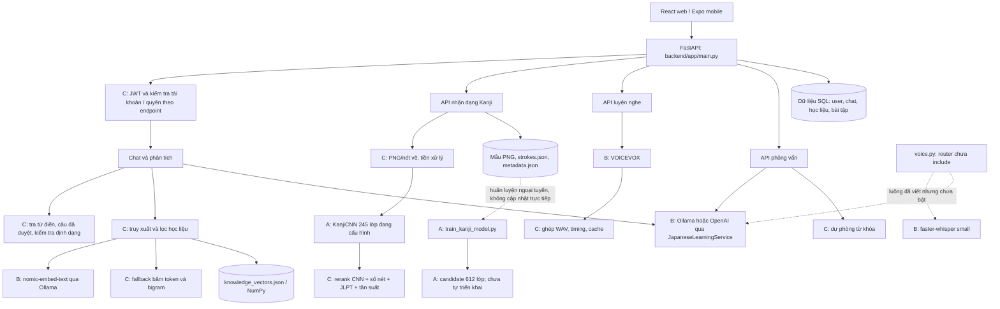

# Báo cáo kỹ thuật AI của SenpaiAI — tài liệu học và bảo vệ trước hội đồng

**Ngày khảo sát: 16/11/2026. Nhánh: `mobile`; HEAD lúc khảo sát: `3157598841` — tự đọc bằng Git.** Báo cáo phản ánh **cả mã đang chỉnh sửa và file chưa commit trong workspace**, không chỉ nội dung của commit này. Không dùng các lời giới thiệu ở README để thay cho việc đối chiếu mã đang chạy.

**Phương pháp:** đọc mã, cấu hình, tài liệu, JSON, thư mục ảnh và trọng số cục bộ; đọc checkpoint bằng `torch.load(..., map_location='cpu', weights_only=True)` để lấy metadata và kích thước tensor. Không chạy huấn luyện, suy luận trên dữ liệu người dùng, gọi LLM, khởi động dịch vụ, migration hoặc test có thể ghi dữ liệu. Các lệnh huấn luyện bên dưới chỉ là hướng dẫn, **không được thực thi trong lần khảo sát này**. Không trích khóa API, mật khẩu hay nội dung hội thoại riêng.

Quy ước xuyên suốt:

- **[A] Tự huấn luyện:** dự án có pipeline tối ưu trọng số từ dữ liệu và có artifact tương ứng. Trong repo tìm thấy một họ mô hình: **KanjiCNN**, gồm bản chính và các bản thử nghiệm.
- **[B] Mô hình có sẵn:** gọi LLM, embedding, ASR hoặc TTS đã được nhà cung cấp huấn luyện; thay prompt, thêm RAG hoặc đổi tham số suy luận **không phải huấn luyện lại**.
- **[C] Luật/thuật toán:** tra từ điển, regex, chấm đáp án, tính hình học, truy xuất và xếp hạng theo công thức, cache, luật trò chơi. Chúng có giá trị kỹ thuật nhưng không tự trở thành mô hình học máy.
- **Đã thấy trong mã/artifact** khác **đã kiểm chứng vận hành**. Báo cáo ghi rõ khi chức năng chưa được nối vào ứng dụng hoặc chưa có số liệu đo. “Tự đếm” là đếm trên workspace lúc khảo sát; không phải thống kê do nhà cung cấp công bố.

## 1. Tóm tắt nhanh một trang

SenpaiAI là hệ thống hỗ trợ người Việt học tiếng Nhật, kết hợp **CNN nhận dạng ảnh tự huấn luyện [A]**, **mô hình ngôn ngữ và âm thanh có sẵn [B]**, với **học liệu và lớp kiểm soát theo luật [C]**. Điểm nên bảo vệ là cách ghép các phần thành quy trình học, không phải tuyên bố nhóm đã tự huấn luyện một LLM tiếng Nhật.

| Chức năng | Loại | Công nghệ và phạm vi thực tế | Bằng chứng chính | Độ chắc chắn |
| --- | --- | --- | --- | --- |
| Nhận dạng Kanji viết tay | [A] + [C] hậu xử lý | PyTorch KanjiCNN; bản chính có 245 lớp, chưa có N3; xếp hạng lại bằng metadata | `backend/ml/kanji_recognizer.py::KanjiRecognizer`; `backend/app/services/kanji_recognition_service.py::_ml_predictions` | Cao: đọc mã, label map và trọng số; chưa có accuracy viết tay độc lập |
| Bản thử mở rộng nhận dạng N3 | [A] | `n3_candidate`: 612 lớp, checkpoint epoch 1; chưa thay bản chính | `backend/ml/models/n3_candidate/{label_map.json,checkpoint_last.pt}` | Cao về artifact; chưa đủ bằng chứng nghiệm thu |
| Chat hỏi đáp có ngữ cảnh | [B] + [C] | LLM Ollama hoặc OpenAI; ưu tiên một số câu trả lời đã kiểm duyệt và tra cứu | `backend/app/api/chat.py::send_message`; `backend/app/services/llm_service.py::chat_response` | Cao về luồng; chưa có benchmark chất lượng tổng thể |
| Dịch Nhật–Việt/Việt–Nhật | [B] | Prompt dịch trên cùng LLM; `confidence=0.9` là giá trị cố định khi thành công | `backend/app/api/analysis.py::translate_text`; `backend/app/services/ollama_service.py::translate_text` | Cao; không có điểm chất lượng dịch đã đo |
| Phân tích ngữ pháp | [B] + [C] | LLM xuất JSON, kiểm tra ngôn ngữ/evidence và đối chiếu mẫu đã duyệt | `backend/app/services/{llm_service,grammar_analyzer,grammar_grounded,grammar_reviewed}.py` | Cao; luật không phải bộ phân tích cú pháp đầy đủ |
| Gợi ý cấp độ JLPT văn bản | [B]; kiểm tra định dạng [C] | Hỏi LLM chọn N5–N1; một số lỗi trả mặc định N3 | `backend/app/api/analysis.py::predict_jlpt_level`; `llm_service.py::predict_jlpt_level` | Cao; không có classifier JLPT tự huấn luyện |
| Tìm kiếm ngữ nghĩa học liệu | [B] embedding + [C] truy xuất | `nomic-embed-text`, vector 768 chiều; fallback băm token/bigram; cosine bằng NumPy | `backend/app/services/vector_db.py::ChromaDBService` | Cao về mã; không xác minh được provenance của vector đã lập chỉ mục |
| RAG cho chat | [B] + [C] | Tìm học liệu, lọc liên quan rồi ghép ngữ cảnh vào prompt | `backend/app/api/chat.py::send_message`; `chat_grounding.py::relevant_chat_documents` | Cao về luồng; chưa có Recall@k/độ đúng dẫn nguồn |
| Sinh câu hỏi ngữ pháp, kể cả từ tài liệu | [B] sinh + [C] kiểm tra/chấm | JSON qua validator; lưu câu có `source='ai'`; chấm đáp án không cần LLM | `grammar_practice_service.py`; `backend/app/api/grammar_practice.py` | Cao; qua schema không đồng nghĩa nội dung đúng |
| Sinh bản nháp bài nghe từ tài liệu | [B] + [C] | LLM tạo hội thoại ja/vi, kiểm tra cấu trúc; sau đó TTS | `backend/app/services/listening_from_library.py::generate_listening_draft` | Cao về mã; chưa thấy đánh giá giáo viên trên toàn bộ đầu ra |
| Tạo âm thanh luyện nghe | [B] TTS + [C] ghép/cache | VOICEVOX, WAV, mốc thời gian từng câu | `backend/app/services/audio_service.py`; `backend/app/api/listening.py::get_lesson_audio` | Cao về tích hợp; giọng/model con của engine chưa được đóng đinh trong repo |
| Chép chính tả, điền khuyết, hiểu bài nghe | [C] | Sinh/chấm từ transcript đã xuất bản, chuẩn hóa Unicode/kana | `backend/app/services/listening_exercises.py` | Cao; không phải LLM chấm nghe |
| Chuyển giọng nói thành chữ | [B], **chưa nối router hiện tại** | `faster-whisper`, mặc định `small`; không huấn luyện lại | `backend/app/services/stt_service.py`; `backend/app/api/voice.py`; `backend/app/main.py` | Cao về mã; chưa thể gọi là tính năng backend đã bật |
| Nhập vai giọng nói, sửa câu, tóm tắt hội thoại | [B] + [C], **chưa nối router hiện tại** | LLM + lịch sử; JSON feedback; `_audio_url()` trả `None` | `backend/app/api/voice.py`; `backend/app/services/voice_scenarios.py` | Cao về mã; chưa xác minh hoạt động đầu cuối |
| Phỏng vấn/công sở Nhật và nhận xét | [B] + [C] dự phòng | LLM chấm grammar/keigo/manner; khi lỗi dùng từ khóa và điểm cố định | `backend/app/services/internship_service.py::evaluate_turn_with_ai` | Cao; chưa có đối chiếu điểm với chuyên gia |
| Nhập giọng nói/phát âm trong phỏng vấn web | [B] do nền tảng cung cấp; phần gọi [C] | Web Speech API của trình duyệt, khác Whisper/VOICEVOX | `frontend/src/components/internship/{PlayerControl,DialogueBox}.tsx` | Cao về API được gọi; nhà cung cấp thực thi chưa xác định |
| Học Kanji, nét viết, luyện viết và quiz nhanh | [C], có gọi API phát âm nền tảng | Từ điển, KanjiVG, romaji, đáp án và hình học; không phải CNN chấm toàn bộ chất lượng viết | `frontend/src/pages/Kanji.jsx::scorePractice`; `frontend/src/components/kanji/KanjiStudy.jsx` | Cao |
| Minigame, quiz/flashcard nhập thủ công hoặc từ file | [C] | TypeScript thuần, lựa chọn dữ liệu, luật chơi, chấm/lưu điểm; parser file | `shared-games/`; `backend/app/services/game_service.py`; `backend/app/api/game.py` | Cao; tên `generate_quiz` không chứng minh có LLM |
| Gợi ý học tập bằng LLM | [B], mức hàm dịch vụ | Có `generate_learning_suggestions`; chưa tìm thấy API trong repo gọi tới chức năng này | `backend/app/services/{llm_service,ollama_service}.py` | Cao về sự tồn tại; chưa xác định tính năng UI thực dùng |
| Nhiệm vụ, thống kê điểm yếu, chuỗi học | [C] | Tổng hợp lịch sử, chọn dữ liệu và tính điểm theo luật | `backend/app/services/daily_task_service.py`; `backend/app/api/grammar_practice.py::get_stats` | Cao; chưa thấy mô hình recommendation được huấn luyện |

**Những điều phải nhớ khi lên sân khấu:** từ điển có 612 chữ không có nghĩa CNN nhận dạng được 612 chữ; validation 85,68% của bản thử không phải accuracy viết tay thực tế; tên ChromaDB trong README không phản ánh đúng cách lưu/truy xuất hiện tại; “chạy cục bộ” là tại máy chủ triển khai, không nhất thiết trên điện thoại. Các số lớp lấy từ label map/dictionary ở mục 3; điểm validation lấy trực tiếp từ checkpoint, không từ mô tả quảng bá.

## 2. Sơ đồ kiến trúc AI tổng thể

**[A/B/C] Cách đọc sơ đồ:** mô hình thực hiện dự đoán/sinh nội dung; các nhánh C chuẩn bị, kiểm tra hoặc chấm theo quy tắc. Tài khoản, dữ liệu SQL và giao diện không phải một mô hình AI. Không có mũi tên từ một câu chat hay một lần sửa Kanji tới việc tức thời thay trọng số.

**Bằng chứng:** [entry point FastAPI](../backend/app/main.py), [API chat](../backend/app/api/chat.py), [LLM service](../backend/app/services/llm_service.py), [vector service](../backend/app/services/vector_db.py), [nhận dạng](../backend/app/services/kanji_recognition_service.py), [âm thanh](../backend/app/services/audio_service.py). `voice.py` không nằm trong danh sách import/include router ở entry point hiện tại. Có file test cho voice không tự động chứng minh router được bật ở ứng dụng chính.

## 3. [A] Mô hình tự huấn luyện: họ KanjiCNN

### 3.1. Bài toán và phạm vi triển khai

**[A] Bài toán:** phân loại ảnh chứa **một chữ Kanji** vào tập nhãn hữu hạn; không phải OCR cả trang, nhận dạng một câu hay mô hình sinh chữ. Backend biến ảnh thành tensor grayscale `[1, 1, 64, 64]` ở cấu hình runtime mặc định. Mạng xuất logits cho từng lớp; softmax biến chúng thành các điểm tương đối rồi lấy top-k. Bằng chứng: [KanjiCNN.forward](../backend/ml/kanji_model.py), [KanjiRecognizer.predict và preprocess_pil_image](../backend/ml/kanji_recognizer.py).

| Artifact [A] | Số lớp — tự đếm label map | Số tham số học được — tự đếm tensor, bỏ buffer BatchNorm | Trạng thái |
| --- | ---: | ---: | --- |
| `backend/ml/models/kanji_model.pt` + `label_map.json` | 245 = 79 N5 + 166 N4 | 2.612.149 | Đường dẫn mặc định thực sự được `KanjiRecognizer` nạp |
| `backend/ml/models/n3_candidate/kanji_model.pt` + `label_map.json` | 612 = 79 N5 + 166 N4 + 367 N3 | 2.800.420 | Ứng viên; không phải đường dẫn mặc định |
| `backend/ml/models/n3_smoke/kanji_model.pt` + `label_map.json` | 612 | 2.800.420 | Thử thông pipeline trên dữ liệu nhỏ; không phải mô hình triển khai |

**[A] Phương pháp đếm:** đọc `state_dict` bằng PyTorch trên CPU; cộng `numel()` của tensor trọng số/bias, loại khóa `running_mean`, `running_var`, `num_batches_tracked`; đối chiếu lớp cuối với shape `[245,512]` hoặc `[612,512]`. Tổng phần tử của toàn state dict bao gồm buffer sẽ lớn hơn số tham số học được; không trộn hai khái niệm. SHA-256 **tự tính** của file chính lúc khảo sát: `57bde58d7d205621b676a957b43c9f980b76c536de221a17b1bb8a18ac2adcce`.

**[C] Từ điển:** tự đếm [kanji_dictionary.json](../backend/app/data/kanji_dictionary.json) có 612 mục, chia cấp như bảng. Metadata và KanjiVG phục vụ tra cứu/nét viết; **không tạo thêm neuron đầu ra cho trọng số 245 lớp**. Danh sách cấp do dự án gán là dữ liệu học tập hiện có, không phải chứng nhận về một danh sách Kanji JLPT chính thức. `kanji_labels.py` lấy nhãn/metadata từ dictionary và có kiểm tra trùng/thiếu dữ liệu.

### 3.2. Nguồn dữ liệu, số mẫu và quyền sử dụng

| Nguồn cho [A] | Thực tế tự đếm trong workspace | Ý nghĩa và giới hạn |
| --- | --- | --- |
| `backend/ml/data/synthetic_kanji` | 245 thư mục lớp; mỗi lớp 350 ảnh; tổng 85.750 ảnh | Ảnh tổng hợp từ font. Sự hiện diện của thư mục **không chứng minh** toàn bộ số ảnh này đã được dùng trong lần huấn luyện tạo trọng số chính |
| `backend/ml/data/n3_candidate_synthetic` | 612 lớp; mỗi lớp 350 ảnh; tổng 214.200 ảnh | Bể ảnh cho pipeline ứng viên. Không có summary hoàn tất để xác nhận đầy đủ provenance của lần chạy candidate |
| `backend/ml/data/n3_smoke` | 612 lớp; mỗi lớp 20 ảnh; tổng 12.240 ảnh | Summary smoke xác nhận dùng 12.240 synthetic + 2 mẫu hiệu chỉnh lúc chạy |
| `backend/ml/data/n3_smoke_eval` | 3 ảnh, một ảnh ở mỗi thư mục 日, 会, 才 | Bộ kiểm tra rất nhỏ; không phải tập viết tay độc lập đủ tin cậy |
| `backend/ml/data/etl10_processed` | **Không tồn tại lúc khảo sát** | Có script đọc ETL, nhưng không được tuyên bố hiện đã có tập ETL thật trên máy này |
| `backend/ml/user_samples` | 68 thư mục có mẫu/metadata; 3 metadata có `corrected_kanji`; 2 nhãn hiệu chỉnh thuộc dictionary hiện tại | Tự đếm file/metadata, không chứng nhận tất cả PNG đều hợp lệ; một nhãn hiệu chỉnh ngoài dictionary sẽ bị trainer bỏ qua |

**[A/C] Synthetic là gì?** Script vẽ ký tự bằng font tiếng Nhật rồi làm biến dạng ảnh. Đây là dữ liệu có nhãn tự sinh theo luật [C], dùng để huấn luyện CNN [A]; không phải 214.200 lượt người thật viết chữ. Số mẫu mỗi lớp trong hai bể chính đồng đều 350 là kết quả tự đếm, không chỉ lấy mặc định CLI. Bằng chứng: [generate_synthetic_dataset, render_synthetic_sample](../backend/ml/train_kanji_model.py), [script sinh ảnh](../backend/ml/scripts/generate_kanji_dataset.py).

**[A/C] ETL:** [prepare_etl10_dataset.py](../backend/ml/scripts/prepare_etl10_dataset.py) hỗ trợ thư mục ảnh hoặc bản ghi ETL-G; có bước giải mã JIS sang ký tự, giải nén mức xám 4 bit, chuẩn hóa rồi ghi PNG theo nhãn. Mã xử lý record dài 8.199 byte, ảnh giải mã 127×128; đây là thông số **bộ đọc trong code**, không phải thống kê tập ETL đã tải. Không tìm thấy trong repo một bản điều khoản ETL đã chấp thuận hoặc bằng chứng dataset ETL đầy đủ đang được sử dụng.

**[C] Giấy phép cần phân biệt:** KanjiVG ghi nguồn và CC BY-SA 3.0 trong [kanjivg_service.py](../backend/app/services/kanjivg_service.py); metadata N5/N4 có nguồn KANJIDIC/kanji-data và điều kiện dữ liệu trong [KANJI_METADATA_SOURCES.md](../backend/scripts/data/KANJI_METADATA_SOURCES.md), N3 có [kanji_n3_sources.md](kanji_n3_sources.md). Đây là quyền của dữ liệu nét/từ điển, **không mặc nhiên bao trùm quyền tái phân phối font hoặc ảnh render từ font**. Repo tìm font cài trên máy Windows/macOS/Linux; chưa tìm thấy hồ sơ giấy phép đầy đủ cho toàn bộ các font được summary smoke liệt kê. Cần kiểm tra trước khi phát hành dataset hoặc trọng số công khai.

### 3.3. [C] Tiền xử lý, augmentation và cân bằng mẫu cho [A]

**Khi suy luận:** giải mã base64/PNG → nếu có alpha thì ghép nền trắng → grayscale → autocontrast → lấy vùng mực theo ngưỡng `<245` → crop bounding box → thu nhỏ giữ tỉ lệ vào vùng `image_size-12` → đặt giữa canvas trắng → chia 255 và đảo `1-x` để mực có giá trị cao. Với runtime 64, vùng vẽ tối đa là 52 pixel mỗi chiều — **tự tính từ công thức**, không phải ảnh đầu vào bắt buộc phải có kích thước này. Ảnh trống trả tensor zero; ảnh hỏng trả lỗi. Bằng chứng: `kanji_recognizer.py::{decode_image_data,preprocess_pil_image,preprocess_image_data}`.

**Khi huấn luyện:** ảnh thư mục qua grayscale, crop/center/resize; `image_to_tensor` chuẩn hóa về mực trên nền zero. Khâu huấn luyện thư mục không có đầy đủ bước alpha-composite/autocontrast giống inference; đó là điểm cần kiểm tra tính nhất quán dữ liệu. Augmentation chủ yếu xảy ra **khi sinh PNG**, không phải tất cả ảnh thư mục đều được biến đổi ngẫu nhiên lại ở mỗi epoch. Có lớp `SyntheticKanjiDataset` sinh động, nhưng luồng `main()` hiện ghi/đọc `FolderKanjiDataset` cho nguồn synthetic. Bằng chứng: `train_kanji_model.py::{crop_center_resize,image_to_tensor,FolderKanjiDataset,main}`.

| Augmentation [C] | Tham số ghi trong `train_kanji_model.py` |
| --- | --- |
| Render cơ sở | Canvas 128×128; font size ngẫu nhiên 72–108; mực 0–35 |
| Scale/vị trí | Tỉ lệ 0,88–1,12; dịch vị trí ban đầu tới ±9 px |
| Độ dày | MinFilter 3×3 khi roll <0,28; MaxFilter 3×3 khi 0,28≤roll<0,42 |
| Xoay/affine | Xoay ±10°; shear mỗi hướng ±0,05; affine shift ±4 px |
| Blur | Xác suất 0,45; bán kính 0,1–0,65 |
| Noise | Xác suất 0,35; nhiễu Gaussian có độ lệch chuẩn chọn trong 3–12 |
| Offset nét | Xác suất 0,28; dịch 1–2 px rồi kết hợp ảnh |
| Elastic | Xác suất 0,22; lưới 4 px; jitter chọn trong 1,5–4 px |

**[C] Kiểm tra font:** `font_missing_kanji`/`validate_fonts` kiểm tra glyph theo cmap nếu có fontTools; loại font thiếu chữ. Truyền `--font` tường minh mà thiếu glyph sẽ dừng. Việc glyph tồn tại chưa đảm bảo ảnh render giống chữ viết tay người dùng.

**[C] Cân bằng cho [A]:** synthetic có trọng số nguồn 1; ETL khi có là 3; mẫu người dùng có nhãn sửa là 6. `WeightedRandomSampler` dùng `source_weight / tổng trọng số của lớp trong train`, lấy có hoàn lại; giúp cân bằng lớp đồng thời ưu tiên mẫu người thật/hiệu chỉnh. Chỉ metadata có `corrected_kanji` nằm trong label map mới được `UserSampleDataset` chọn. Không phải mọi lần dự đoán đã lưu đều trở thành nhãn huấn luyện.

### 3.4. [A] Kiến trúc và lý do chọn

Theo [kanji_model.py::KanjiCNN](../backend/ml/kanji_model.py):

1. Conv 3×3, padding 1: 1→32; BatchNorm, ReLU, MaxPool 2.
2. Conv: 32→64; BatchNorm, ReLU, MaxPool 2.
3. Conv: 64→128; BatchNorm, ReLU, MaxPool 2.
4. Conv: 128→256; BatchNorm, ReLU, AdaptiveAvgPool về 4×4.
5. Flatten 4.096 đặc trưng; Dropout 0,35; Linear 4.096→512; ReLU; Dropout 0,25; Linear 512→số lớp.

**Giải thích:** convolution học mẫu nét cục bộ; pooling giảm kích thước; BatchNorm ổn định phân bố kích hoạt; dropout ngẫu nhiên bỏ bớt đơn vị lúc train để hạn chế học thuộc; lớp cuối chọn chữ. Đây là mô hình phân loại ảnh tương đối nhỏ. **Suy luận từ code**, không phải kết luận từ thí nghiệm so sánh: kiến trúc này thuận tiện suy luận CPU và phù hợp ảnh một ký tự. Không tìm thấy báo cáo ablation so sánh CNN này với ResNet, Transformer hay mô hình nét theo thời gian; không được nói nhóm đã chứng minh đây là kiến trúc tối ưu.

### 3.5. [A] Huấn luyện: điều gì là cấu hình, điều gì đã thực chạy

| Thành phần | Bằng chứng trong trainer; không gán mặc định cho artifact cũ |
| --- | --- |
| Nhãn | Lấy thứ tự từ dictionary N5/N4/N3; kiểm tra bộ nhãn đầy đủ; các cờ hạn chế nhãn vẫn có thể bị kiểm tra cuối từ chối |
| Seed | `random.seed(42)`, `np.random.seed(42)`, `torch.manual_seed(42)` |
| Chia dữ liệu | `val_size=max(số_lớp, int(0.15*N))`, chặn tối đa `N-1`; phần còn lại train; `random_split` theo ảnh |
| Test độc lập | Không có phần chia test độc lập trong `main()` |
| Loss | CrossEntropyLoss cho phân loại nhiều lớp |
| Optimizer | AdamW; learning rate mặc định 0,001; weight decay 0,0001 |
| Batch | `--batch-size` mặc định 0 nghĩa tự chọn: CUDA 128, CPU 64 |
| Epoch | CLI mặc định 50; không phải bằng chứng bản chính đã chạy 50 epoch |
| Thiết bị | Chọn CUDA nếu `torch.cuda.is_available()`, nếu không CPU; `num_workers=0` |
| Chống overfit | Dropout, weight decay, augmentation và chọn checkpoint có validation tốt nhất; không thấy early stopping hoặc lịch giảm learning rate trong vòng lặp này |
| Checkpoint | `kanji_model.pt` lưu state tốt nhất; `label_map.json` cùng thứ tự; `checkpoint_last.pt` lưu epoch/model/optimizer/accuracy/image_size; `--resume` tiếp tục epoch kế |
| Summary | `training_summary.json` được ghi cuối lượt chạy, có cấu hình, đếm nguồn/lớp và giây/epoch |

**[A] Kết quả hiện có đọc trực tiếp:**

| Bản | Số liệu có nguồn | Diễn giải đúng |
| --- | --- | --- |
| Chính 245 lớp | Có state dict; **không tìm thấy log/summary** gắn chắc chắn với lần tạo artifact này | Chưa xác định epoch, batch, dữ liệu thực dùng, thời gian train và validation/test accuracy của bản chính |
| Candidate 612 lớp | `checkpoint_last.pt`: `epoch=1`, `image_size=64`, `best_accuracy=0.8568004979769686`; theo cấp N5 `0.8587476099426387`, N4 `0.8608354488806831`, N3 `0.8545643153526971`; optimizer lưu lr `0.001`, weight decay `0.0001` | Khoảng **85,68% validation** ghi trong checkpoint; không phải accuracy người dùng. Không có `training_summary.json` hoàn tất ở thư mục này; chưa xác định chính xác số epoch ban đầu yêu cầu hoặc thời gian epoch |
| Smoke 612 lớp | `training_summary.json`: 1 epoch, batch 64, lr 0,001, 20 ảnh tổng hợp/lớp, 2 mẫu người dùng; best validation `0.007080610021786492`; N5 `0.02553191489361702`, N4 `0`, N3 `0.006329113924050633`; thời gian epoch `171.37744749999547` giây | Khoảng **0,71% validation**, chỉ kiểm tra pipeline; không dùng làm kết quả chất lượng |

**[A] Về thiết bị:** README ML mô tả smoke chạy CPU; summary smoke không có trường device. Không suy ra GPU hay loại CPU từ việc dùng `map_location='cpu'` khi đọc checkpoint. Các số 350/50 ở CLI hoặc 214.200 ảnh hiện có không thay thế hồ sơ lần chạy candidate.

**[C] Nguy cơ chia dữ liệu:** `random_split` không tách theo người viết, font hoặc phiên thu thập và không phân tầng riêng từng lớp. Các biến thể cùng font và các mẫu cùng nguồn có thể có mặt ở cả train/validation; validation trên synthetic có thể cao trong khi viết tay thật thấp. Chưa thấy manifest lưu danh sách file của từng split. Seed giúp tái lập phần nào, nhưng thêm/bớt file hoặc đổi thứ tự duyệt thư mục có thể đổi split.

### 3.6. [A/C] Thứ tự huấn luyện lại có trong repo

Thực hiện từ `backend/`, sau khi xác nhận môi trường và quyền dùng dữ liệu; **đây là hướng dẫn, chưa chạy trong đợt báo cáo**:

1. Kiểm tra dictionary bằng `python scripts/validate_kanji_dictionary.py`; đọc nguồn/giấy phép dữ liệu và font.
2. Nếu có ETL thật, chạy `python ml/scripts/prepare_etl10_dataset.py --etl10-path <duong-dan-ETL-thuc> --output ml/data/etl10_processed --model-dir ml/models/n3_prepared`. Thay placeholder bằng đường dẫn thật. Quan trọng: script này có thể ghi label map; **không để mặc định ghi vào thư mục mô hình chính** khi chỉ chuẩn bị dữ liệu.
3. Tạo synthetic riêng bằng `python ml/scripts/generate_kanji_dataset.py --output ml/data/n3_candidate_synthetic --samples-per-class 350 --image-size 64`.
4. Huấn luyện ứng viên bằng `python ml/train_kanji_model.py --artifact-dir ml/models/n3_candidate --synthetic-dir ml/data/n3_candidate_synthetic --samples-per-class 350 --image-size 64 --epochs 50 --batch-size 64`. Đây là cấu hình đề xuất trong README, không bảo đảm thời gian hay chất lượng.
5. Chỉ thêm `--resume` nếu nhãn, dữ liệu, image size và các tham số tương thích với checkpoint. Lưu command, commit, danh sách split, seed, phần cứng, log và summary cho lần mới.
6. Đánh giá thật bằng `python ml/scripts/evaluate_kanji_models.py --dataset <tap-viet-tay-heldout> --old-model-dir ml/models --candidate-model-dir ml/models/n3_candidate`.
7. Sau khi nghiệm thu mới thay **cặp** trọng số/label map ở đường dẫn chuẩn, có bản sao rollback và khởi động lại backend. Không thay lẻ label map; số neuron và thứ tự nhãn phải khớp.

Nguồn: [README ML](../backend/ml/README.md), [trainer](../backend/ml/train_kanji_model.py), [bộ đọc ETL](../backend/ml/scripts/prepare_etl10_dataset.py), [script đánh giá](../backend/ml/scripts/evaluate_kanji_models.py). `train_kanji_cnn.py` chỉ là wrapper gọi `main()` của trainer, không phải mô hình huấn luyện thứ hai.

### 3.7. [A/C] Đánh giá: đã đo gì và còn thiếu gì

**Đã có:** trainer đo loss và top-1 accuracy trên train/validation; validation theo JLPT. Script `evaluate_kanji_models.py` tính top-1, top-5 theo cấp, liệt kê 20 cặp nhầm top-1 phổ biến, cảnh báo nếu candidate N5/N4 giảm so với bản cũ. Chưa tìm thấy file kết quả đánh giá viết tay held-out đầy đủ cho bản chính/candidate trong các đường dẫn khảo sát. Có script đánh giá không đồng nghĩa đã có kết quả.

**Điểm cần thận trọng:** evaluator gọi trực tiếp `KanjiRecognizer.predict`, còn API người dùng có rerank bằng metadata. Vì vậy cần đo **cả CNN thuần [A] và toàn pipeline [A+C]** trên cùng ảnh/nét đầu vào. Mạng hiện trả top-20 trước rerank và API trả top-5; không nên báo accuracy của một đường đo thành accuracy của đường khác.

**Đề xuất đo, chưa phải số liệu:** thu tập viết tay thật có đồng ý sử dụng, tách người viết giữa train và test, phủ các cấp hỗ trợ. Ghi số mẫu từng lớp, top-1/top-5, macro recall theo lớp, confusion matrix, accuracy khi chấp nhận theo ngưỡng, tỷ lệ từ chối, độ trễ và lỗi riêng cho ảnh trống/alpha. Không dùng lại mẫu đã hiệu chỉnh để vừa train vừa báo test độc lập. `tests/test_kanji_recognizer.py` và `tests/test_kanji_recognition_service.py` kiểm tra hành vi phần mềm, không thay phép đo nhận dạng trên người thật.

### 3.8. [A+C] Suy luận, ngưỡng và cơ chế sửa sai

**[A] Nạp và dự đoán:** `KanjiRecognizer._load()` đọc `models/label_map.json`, dựng CNN đúng số lớp, nạp state dict, đặt `eval()`, chạy `torch.no_grad()` trên CPU. Nếu thiếu file/runtime hoặc ảnh không hợp lệ, hệ thống trả trạng thái không sẵn sàng/lỗi; không phải một CNN mới tự sinh đáp án. `predict()` bỏ qua tham số `strokes` và `jlpt_level` ở tầng CNN; các tham số này được dùng ở service hậu xử lý [C].

**[C] Rerank trong `KanjiRecognitionService._ml_predictions`:**

`điểm = 0,70 × softmax_CNN + 0,15 × hợp_số_nét + 0,10 × hợp_JLPT + 0,05 × tần_suất`.

API lấy top-20 từ CNN, tính công thức, sắp xếp và giữ top-5; điểm hiển thị bị chặn 0,01–0,99 và làm tròn. `CONFIDENCE_THRESHOLD=0.65` gắn cờ thấp trên **điểm tổng hợp**, không phải xác suất đã hiệu chuẩn. Các trọng số là luật ghi trong code, không phải một mô hình ensemble được học từ dữ liệu. Softmax cao cũng không đảm bảo ảnh đúng, đặc biệt ngoài tập phân phối đã học.

**[C] Lưu sửa sai:** `recognize()` lưu PNG/nét của ảnh hợp lệ; endpoint `save_kanji_correction` lưu nhãn người dùng sửa. [KanjiSampleStore](../backend/app/services/kanji_sample_store.py) ghi thư mục gồm `image.png`, `strokes.json`, `metadata.json`; metadata chứa ID mẫu, thời gian, nguồn, nhãn dự đoán/hiệu chỉnh và JLPT, không có trường user ID trong định dạng hiện thấy. Trainer chỉ lấy mẫu có nhãn sửa thuộc bộ nhãn. Chưa có cập nhật online tự động, hàng duyệt nhãn hay chống cố tình gán nhãn sai được thể hiện trong pipeline này.

### 3.9. [A/C] Hạn chế và lỗi đã biết

- **N3 không nằm trong bản chính:** 367 chữ N3 có metadata nhưng không thể xuất hiện ở đầu ra mạng 245 lớp. Chỉ có candidate 612 lớp chưa nghiệm thu.
- **N4/N5 vẫn có thể nhận sai nét viết tay:** dữ liệu synthetic khác nét tay, biến dạng mạnh hoặc tiền xử lý lệch; đây là nguyên nhân có cơ sở kỹ thuật, **chưa được định lượng bằng thí nghiệm loại trừ nguyên nhân**.
- **語 và 東:** [KANJI_RECOGNITION_DIAGNOSIS.md](KANJI_RECOGNITION_DIAGNOSIS.md) ghi chúng thuộc nhãn mô hình, nhưng trước đây UI chặn nhầm vì thiếu thumbnail ETL. Bỏ chặn thumbnail không chứng minh CNN đã nhận đúng các kiểu viết. Không có confusion matrix để khẳng định đây là hai lớp sai nhiều nhất.
- **Ảnh trắng/alpha:** code hiện ghép alpha nền trắng, nhận ảnh trống, không lưu ảnh hỏng/rỗng thành mẫu. Đó là sửa lỗi kỹ thuật [C], không phải thêm lớp hay tăng accuracy đã đo.
- **Dữ liệu từ điển từng thiếu:** [KANJI_STUDY_AUDIO_REPAIR.md](KANJI_STUDY_AUDIO_REPAIR.md) mô tả bổ sung N5/N4. Đây là cải thiện nghĩa/cách đọc/số nét [C], không phải huấn luyện lại CNN [A].
- **Chấm luyện viết khác nhận dạng:** `frontend/src/pages/Kanji.jsx::scorePractice` dùng số nét, tỉ lệ, vị trí, độ mượt và quy tắc có xử lý riêng cho 月; không phải mô hình hiểu/thẩm định toàn bộ thứ tự nét chuẩn cho mọi chữ. Không quảng bá điểm luyện viết như đánh giá thư pháp chuyên gia.

## 4. [B] Các mô hình có sẵn và lớp kiểm soát [C]

### 4.1. [B] LLM dùng ở đâu, model nào thực sự được cấu hình

| Nguồn cấu hình trong repo | Giá trị quan sát được | Cách diễn giải |
| --- | --- | --- |
| `backend/app/core/config.py::Settings` | `llm_provider='ollama'`, `ollama_model='qwen2.5:3b'` | Mặc định Python nếu không bị môi trường ghi đè |
| `backend/.env` tại workspace — chỉ đọc các trường không bí mật | `LLM_PROVIDER=ollama`, `OLLAMA_MODEL=gemma:2b`, URL Ollama localhost:11434 | Giá trị file môi trường cục bộ lúc khảo sát; biến môi trường của tiến trình có thể còn ghi đè |
| `backend/env.example` và `docker-compose.yml` | Gemma `gemma:2b`; Compose trỏ Ollama qua tên dịch vụ | Ví dụ/luồng container khác mặc định Python |
| `JapaneseLearningService.__init__` khi provider không phải Ollama | `ChatOpenAI(model_name='gpt-3.5-turbo')`; chat temperature 0,7, max_tokens 1.000; grammar temperature 0 | Nhánh dùng dịch vụ có sẵn, không phải tự động chuyển sang OpenAI mỗi khi Ollama hỏng |

**[B] Kết luận:** không được nói toàn dự án dùng cố định Qwen hoặc Gemma chỉ dựa một file. Cấu hình local quan sát là Gemma; model thực được tiến trình/container khác nạp phải kiểm tra tại môi trường demo. Không tìm thấy checkpoint fine-tune, LoRA hay script huấn luyện LLM trong phần mã dự án khảo sát. Hệ thống điều khiển bằng prompt/RAG và tham số suy luận, không cập nhật trọng số LLM.

**[B/C] Cách gọi:** `OllamaJapaneseLearningService._call_ollama` có temperature mặc định 0,3, `num_ctx=2048`, `num_thread=6`, `repeat_penalty=1.12`, mặc định `num_predict=350`; chat yêu cầu 220 token. Đường JSON-schema gửi HTTP `/api/chat`, timeout 90 giây, kiểm tra câu trả lời chưa hoàn tất; đường thường dùng SDK `ollama.chat`, có fallback `generate`/retry. Đây là giới hạn code, không phải độ trễ thực đo hay độ dài được đảm bảo.

**[B/C] Rủi ro cấu hình:** đường HTTP có dùng `self.base_url`; các lời gọi SDK `ollama.chat/generate/list` không truyền explicit host trong các hàm đang đọc. Cần xác minh host mặc định của SDK/môi trường khi chạy Compose hoặc server khác; không mặc nhiên cho rằng mọi nhánh đều theo `OLLAMA_BASE_URL`. Nhánh OpenAI có import dự phòng giữa các gói LangChain; cấu hình tên model không chứng minh tài khoản API hiện còn gọi được model đó.

### 4.2. [B+C] Chat và dịch

**Chat:** `chat.py::send_message` kiểm tra hội thoại thuộc tài khoản, lấy lịch sử có giới hạn, rồi ưu tiên: tra một chữ Kanji → câu đã duyệt/quy tắc → chào hỏi → kiểm tra yêu cầu dịch cùng ngôn ngữ → tham chiếu/RAG → LLM. Các câu trả lời trực tiếp đầu tiên thuộc [C], không phải mỗi lần chat đều gọi model. `chat_prompt.py::build_chat_system_prompt` yêu cầu đúng ngôn ngữ, ví dụ Nhật ngắn, tránh lan man; `chat_grounding.py` và `chat_language.py` làm sạch/kiểm tra đầu ra.

**Giảm rủi ro có thật [C]:** lọc nguồn không liên quan, dùng tri thức đã duyệt cho một số câu, hướng dẫn model chỉ dùng nguồn liên quan, kiểm tra ngôn ngữ và sửa đầu ra. Khi LLM lỗi mà có context, nhánh Ollama có thể trả nội dung tham khảo; không có context thì báo lỗi. Đây không phải đảm bảo không ảo giác. Comment “100% dictionary accuracy” hoặc “zero RAG hallucination” trong `chat.py` không phải phép đo khoa học, và báo cáo không nhận chúng làm kết quả.

**Dịch [B]:** system prompt yêu cầu giữ nghĩa/giọng, Nhật→Việt chỉ xuất tiếng Việt, Việt→Nhật tự nhiên. Không tìm thấy bộ mô hình dịch chuyên biệt do nhóm huấn luyện hoặc BLEU/chrF/COMET đã đo. Cả nhánh Ollama và OpenAI trả `confidence=0.9` cố định sau khi thành công; **không được nói bản dịch chính xác 90%**. Khi lỗi, hàm có thể trả thông báo lỗi trong `translated_text` và confidence 0; phía ứng dụng cần phân biệt với nội dung dịch hợp lệ.

### 4.3. [B+C] Phân tích ngữ pháp và ước lượng JLPT

**Ngữ pháp:** `JapaneseLearningService.analyze_grammar` ưu tiên kết quả reviewed/deterministic [C]. Nếu cần LLM [B], có tối đa hai lượt cố lấy đầu ra hợp lệ; Ollama dùng JSON schema, temperature 0; `grammar_generation_prompt` đòi `evidence` nguyên văn và giải thích đúng ngôn ngữ. `grounded_model_analysis` bổ sung/đối chiếu mẫu regex đã duyệt và kiểm tra một số nét nghĩa như mong muốn, phủ định, khả năng; cache kết quả hoàn chỉnh tối đa 256 mục. Lỗi có thể trả phân tích một phần có trạng thái, hoặc API 503 khi không đủ dữ liệu đáng tin.

**Giới hạn:** JSON hợp lệ chỉ xác nhận cấu trúc; evidence có trong câu không chứng minh suy luận ngữ pháp đúng. `grammar_grounded.py` tự mô tả là luật bề mặt bảo thủ, không phải parser đầy đủ; một số câu mẫu được trả theo nội dung đã duyệt. Cần dùng câu mới, câu mơ hồ và câu không có trong bộ luật khi demo đánh giá.

**JLPT [B]:** endpoint `/analysis/jlpt-level` yêu cầu LLM trả một nhãn N5–N1 rồi kiểm tra regex. Khi lỗi/định dạng sai, các hàm `predict_jlpt_level` có fallback **N3**. Không thấy mô hình phân loại JLPT tự huấn luyện hoặc độ chính xác đối chiếu chuyên gia. Trường `is_appropriate` chỉ so nhãn với cấp người dùng, không phải chứng nhận người đó có năng lực JLPT tương ứng. Nhãn/difficulty từ các nhánh phân tích có thể còn do luật [C] hoặc output model; không gộp chúng thành một chuẩn đo đã được hiệu chuẩn.

### 4.4. [B+C] Sinh câu hỏi và bài nghe từ học liệu

**Ngữ pháp:** [grammar_practice_service.py](../backend/app/services/grammar_practice_service.py) có `generate_raw_questions` và `generate_raw_questions_from_document`, gọi Ollama/OpenAI bằng prompt JSON. `GeneratedQuestion.validate_question` kiểm tra cấp, kiểu câu, giải thích, đáp án; điền khuyết phải có một chỗ trống và bốn lựa chọn khác nhau, đáp án nằm trong lựa chọn; sắp xếp có giới hạn số token và phải ghép được đáp án; các kiểu đúng/sai/chia dạng có kiểm tra riêng. `parse_generated_questions` nhận/loại từng câu; API loại câu trùng.

**Giới hạn quan trọng:** câu do AI có thể được ghi `source='ai'`, `is_active=True` ngay trong endpoint; chưa thấy bước bắt buộc giáo viên duyệt trước kích hoạt. Có giới hạn số câu sinh theo người dùng trong cửa sổ thời gian ở API, nhưng đó là kiểm soát tải, không phải kiểm định ngữ nghĩa. `grade_answer` chấm bằng chuẩn hóa/đối chiếu đáp án [C], không gọi LLM cho mỗi câu người học trả lời.

**Bài nghe:** `generate_listening_draft` lấy tối đa 24.000 ký tự tài liệu làm context, yêu cầu hội thoại ngắn ja/vi; validator nhận 4–10 câu, mỗi câu có hai ngôn ngữ, giới hạn độ dài. Đây là **context theo tài liệu được chọn**, không phải một lần tự động tìm top-k trong vector store. Nội dung được duyệt/đưa thành lesson rồi mới có âm thanh và bài tập. Kiểm tra định dạng không đủ bảo đảm tiếng Nhật tự nhiên hay bản dịch đúng.

**Không nhầm với quiz phổ thông [C]:** `backend/app/services/game_service.py::{generate_quiz,create_quiz}` và parser file ở `api/game.py` dùng dữ liệu/cấu trúc có sẵn; không thấy lời gọi LLM tại các hàm này. Tạo quiz/flashcard từ bảng dữ liệu không phải “AI tự sinh câu hỏi” giống nhánh grammar ở trên.

### 4.5. [B+C] Whisper, VOICEVOX và speech API của trình duyệt

**ASR [B]:** `stt_service.py::_get_model` tải `faster_whisper.WhisperModel`, mặc định model `small`; CPU dùng `int8`, thiết bị khác dùng `float16`; tải lười và cache model trong tiến trình. Audio được PyAV giải mã trong bộ nhớ, mono 16 kHz; giới hạn 5 MiB/60 giây; transcribe dùng `beam_size=5`, `vad_filter=True`, tự phát hiện ngôn ngữ theo code. Không tìm thấy fine-tune Whisper. Các thông số trên là code/cấu hình, không phải WER/CER đã đo.

**Confidence ASR [C]:** hàm tổng hợp `exp(avg_logprob) × (1-no_speech_prob)` rồi lấy trung bình các đoạn và chặn về khoảng hợp lệ. Đây là chỉ báo heuristic từ tín hiệu mô hình, không phải điểm phát âm chuẩn hay xác suất đúng đã hiệu chuẩn.

**Trạng thái tích hợp:** `backend/app/api/voice.py` có API transcribe/nhập vai/feedback/tóm tắt và rate limit riêng 10 lượt transcribe/phút/tài khoản. Tuy nhiên [main.py](../backend/app/main.py) hiện không import/include router voice. `_audio_url()` trong voice trả `None`; comment nói thiếu audio service đã lạc hậu so với sự tồn tại của `audio_service.py`, nhưng **hàm voice vẫn chưa nối sang VOICEVOX**. Không trình bày luồng voice này như tính năng đã hoạt động trọn vẹn chỉ vì có mã hoặc test.

**TTS bài nghe [B]:** `VoicevoxProvider` gọi `/speakers`, `/audio_query`, `/synthesis`; Compose dùng `voicevox/voicevox_engine:cpu-latest`. Speaker ưu tiên là 1 nhưng chọn speaker thực dựa danh sách engine. Repo không lưu định danh/checksum trọng số TTS con, cũng chưa có chỉ số độ tự nhiên/phát âm. Ghép WAV, nghỉ 400 ms giữa câu, timing, SHA-256 cache và phục hồi cache trước khi cần engine là [C], không phải huấn luyện TTS.

**Speech của trình duyệt:** `PlayerControl.tsx` dùng `SpeechRecognition/webkitSpeechRecognition`; `DialogueBox.tsx` và `KanjiStudy.jsx` dùng `speechSynthesis`. Đây là khả năng do trình duyệt/hệ điều hành cung cấp [B, chi tiết model chưa xác định], không thể gán tên Whisper/VOICEVOX cho các nút này. Cần kiểm tra quyền microphone, khả năng hỗ trợ từng browser và chính sách mạng của nền tảng; không khẳng định mọi tiếng nói đều xử lý offline tại máy.

### 4.6. [B+C] Phỏng vấn/công sở và gợi ý học tập

**Phỏng vấn [B]:** `internship_service.py::evaluate_turn_with_ai` gửi ngành, người hỏi, câu hỏi Nhật, lượt hiện tại và câu trả lời người học tới LLM; yêu cầu JSON gồm điểm grammar/keigo/manner, câu sửa, lời khuyên Việt và phản hồi NPC Nhật/Việt. Đây là một bài đánh giá theo prompt, không phải mô hình tâm lý, nhận diện cảm xúc khuôn mặt hay phân tích tác phong từ camera. Chưa tìm thấy đánh giá đa phương thức như vậy trong code được khảo sát.

**Dự phòng [C]:** khi gọi/parse LLM lỗi, `generate_heuristic_evaluation` xét có `です/ます`, từ kính ngữ và đại từ, rồi cho các điểm cố định. Ngay cả nhánh thành công cũng chặn từng điểm trong khoảng **50–100**, dù prompt nói 0–100. Vì vậy không thể quảng bá đây là bài thi chấm năng lực khách quan theo thang chuẩn. Điểm và phản hồi cần được đánh giá với giáo viên, đồng thời UI nên phân biệt khi dùng fallback.

**Gợi ý học tập:** hàm LLM `generate_learning_suggestions` có trong hai service [B], nhưng chưa tìm thấy lời gọi API/UI sử dụng nó qua khảo sát call site. Chọn nhiệm vụ hằng ngày, tính weak patterns và thống kê đúng/sai hiện thấy chủ yếu là luật và truy vấn dữ liệu [C]. Không tìm thấy checkpoint một hệ gợi ý cá nhân hóa được tự huấn luyện.

### 4.7. [B] Lý do chọn, đánh đổi và giới hạn có thể bảo vệ

| Lựa chọn | Điều repo hỗ trợ | Đánh đổi/suy luận cần nói rõ |
| --- | --- | --- |
| Ollama local | Hướng dẫn cài Gemma, Compose dịch vụ Ollama, cấu hình localhost/container | Không trả tiền token cho dịch vụ LLM ngoài nếu thật sự dùng local; vẫn tốn RAM/CPU/GPU/điện. Chất lượng Nhật–Việt và độ trễ chưa có benchmark so với OpenAI |
| OpenAI | Nhánh `ChatOpenAI`, API key qua Settings | Dễ dùng model dịch vụ nhưng gửi prompt/context ra nhà cung cấp, có phí API; khả năng gọi model cấu hình hiện tại chưa được kiểm tra |
| Nomic embedding | API Ollama và chiều vector được code kiểm tra | Độ phù hợp cho corpus Nhật–Việt chưa được repo đo; không suy từ tên model ra chất lượng ngôn ngữ |
| Whisper có sẵn | Tải model ASR, không có pipeline train ASR | Tránh tự thu tập speech lớn; cần tài nguyên và kiểm thử tiếng Nhật, tiếng ồn, người Việt phát âm Nhật |
| VOICEVOX | Engine TTS CPU được tích hợp cho bài nghe | Phụ thuộc engine/các voice; cần attribution/điều khoản giọng, kiểm tra ngắt câu và thời gian tạo |

Các lý do về tài nguyên/độ tiện triển khai là **suy luận từ kiến trúc và tài liệu**, không phải kết quả so sánh A/B đã đo. Prompt, RAG và schema giảm một số lỗi nhưng không làm LLM hết ảo giác, không thay kiểm duyệt giáo viên.

## 5. [B+C] RAG và thư viện học liệu, từ nạp đến trả lời

### 5.1. [C] Nạp tài liệu và lưu nguồn

`library.py` hỗ trợ tạo/sửa tài liệu, tải file và lấy URL; `LibraryService` lưu title/content/type/JLPT/tags/source URL vào model SQL `Document`, sau đó `_index_document`. URL chỉ nhận HTTP/HTTPS; lấy HTML/text qua requests, BeautifulSoup loại các phần không cần rồi ghép nội dung. File PDF trích text bằng `pypdf`, Word bằng `docx`, text/Markdown/CSV/JSON thử nhiều encoding. Đây là parsing [C], **không tìm thấy OCR cho PDF ảnh** trong luồng này. Một số parser được import bên trong hàm; không được coi là đã có đủ dependency chỉ vì nhánh mã tồn tại. Nguồn: [library_service.py::{fetch_url_content,extract_file_content,_index_document}](../backend/app/services/library_service.py).

### 5.2. [B+C] Cắt đoạn và embedding: thực tế khác mô tả cũ

**Hiện tại không có chia chunk theo kích thước/overlap trong `add_documents`.** Mỗi document tạo một record `<document_id>_0`; metadata ghi `chunk_index=0`, `total_chunks=1`; embedding dùng `title + newline + toàn bộ content`. Vì vậy câu trả lời về “chunk size bao nhiêu, overlap bao nhiêu” phải là: **không áp dụng bộ chia nhiều đoạn ở luồng hiện tại; không có các thông số đó để báo cáo**. Việc `langchain-text-splitters` có trong requirements hoặc docstring nói “chunk” không chứng minh nó được gọi.

**Embedding [B]:** gọi Ollama `nomic-embed-text` qua `/api/embeddings`, timeout 10 giây; chỉ chấp nhận vector dài 768, chuẩn hóa L2. Chưa tìm thấy huấn luyện embedding trên học liệu SenpaiAI. Không xác định được phiên bản/checksum trọng số Nomic từ repo.

**Fallback [C]:** nếu embedding thất bại, code tự cộng đặc trưng token và bigram ký tự vào vector 768 chiều bằng `hash() % 768`, rồi chuẩn hóa. Đây là **hashing lexical**, không phải mô hình semantic embedding học được. Comment gọi “semantic pseudo-embedding/deterministic” cần đọc thận trọng: `hash()` mặc định của Python có thể đổi giữa tiến trình nếu seed không được cố định; chưa tìm thấy cơ chế lưu seed/provenance vector trong record.

**Hệ quả suy luận từ code:** cùng 768 chiều không có nghĩa cùng không gian ngữ nghĩa. Vector Nomic và vector hash có thể bị trộn; vector hash lưu từ tiến trình trước có thể không tương thích query mới. Cần lưu tên/phiên bản/phương pháp embedding và reindex có kiểm soát; fallback nên được phân luồng rõ thay vì âm thầm thay cùng không gian. Chưa thấy đánh giá định lượng khắc phục các rủi ro này.

### 5.3. [C] Vector store: tên ChromaDB, triển khai JSON/NumPy

`ChromaDBService` hiện dùng dictionary `records` trong RAM, đọc/ghi `CHROMA_PERSIST_DIRECTORY/knowledge_vectors.json`; tính cosine bằng ma trận NumPy, `argsort` lấy kết quả. Không thấy `chromadb.PersistentClient` được dùng trong lớp này, dù `chromadb` còn nằm trong requirements và README/tài liệu cũ mô tả ChromaDB.

**Tự kiểm tra file lúc khảo sát:** cả `chroma_db/` và `backend/chroma_db/` có `chroma.sqlite3`, nhưng **không tìm thấy `knowledge_vectors.json` ở hai thư mục đó**. Sự hiện diện của SQLite cũ không chứng minh service hiện tại đọc được các vector ấy. `app/main.py::lifespan` không có bước tự nạp lại toàn bộ SQL documents vào JSON index. Chưa xác định lượng record đang có trong RAM của server thực tế; không đọc runtime hay giả định index hiện tại chứa toàn bộ học liệu.

**Giới hạn vận hành suy luận [C]:** lưu JSON và quét cosine toàn bộ tập phù hợp prototype nhỏ; không có ANN index ở đây. Ghi qua file tạm giúp thay file nhưng không thấy transaction/lock nhiều worker; nhiều tiến trình có thể giữ bản RAM khác nhau. Không tuyên bố đã có vector DB production phân tán.

### 5.4. [B+C] Truy xuất, lọc và ghép prompt

1. Chat tìm `reviewed_reference` trước. Nếu chưa có context và không phải yêu cầu dịch, tìm vector với `n_results=3`, ưu tiên lọc cấp JLPT.
2. `relevant_chat_documents` chỉ giữ ứng viên qua ngưỡng `MIN_CHAT_RELEVANCE=0.68`, đối chiếu từ Nhật/anchor hoặc từ khóa cụ thể. Một nhánh nhận độ tương đồng rất cao từ 0,78 và giới hạn hai kết quả; nhánh anchor có thể giữ tới ba.
3. Nếu không có nguồn phù hợp khi lọc cấp, tìm lại không lọc cấp. Chào hỏi và một số câu dịch không đưa RAG vào.
4. Ghép tiêu đề, loại/cấp và nội dung từng nguồn thành context; gắn nguồn trả về cho UI. Thêm lịch sử hội thoại thuộc user: tối đa 6 lượt và 6.000 ký tự theo Settings/bộ xây context.
5. Gửi context + câu hỏi + cấp người học tới LLM; nguồn là context suy luận, không trở thành dữ liệu fine-tune trọng số.

Nguồn: `chat.py::send_message`, `chat_grounding.py::relevant_chat_documents`, `chat_conversations.py::build_recent_chat_context`, `core/config.py`. Ngưỡng cosine **không phải** xác suất câu trả lời đúng. Context cả document có thể vượt ngân sách `num_ctx=2048`; chưa thấy chiến lược đóng gói theo tokenizer bảo đảm giữ đủ nguồn/lịch sử.

**Tìm thư viện không giống chat:** `LibraryService.search_documents` lấy `max(limit+offset,limit)` vector candidates, phối hợp kết quả/localization; nếu không có ranked IDs thì dùng tìm từ khóa SQL với relevance cố định 0,35. Đó là fallback [C], không phải điểm semantic do model dự đoán. Không được nói mọi kết quả thư viện đều đã qua embedding thành công.

### 5.5. [C] Cô lập dữ liệu và nguồn riêng tư

**Thư viện là kho chung trong model hiện tại:** `Document` không có `user_id/owner_id`; metadata vector không có user ID; `search_documents`/chat filter chủ yếu theo cấp/loại, không theo tài khoản. Các endpoint sửa/xóa học liệu yêu cầu đăng nhập nhưng service lấy document theo ID, không thấy kiểm tra chủ sở hữu từng tài liệu. Vì vậy **không thể tuyên bố mỗi người có một kho RAG riêng đã được cô lập**. Nguồn: `models/database.py::Document`, `api/library.py`, `library_service.py`, `vector_db.py`.

**Khác với lịch sử chat và bài nghe từ thư viện:** chat kiểm tra user/conversation; lesson nguồn `library` có `created_by` và `_library_lesson_visible` kiểm tra quyền. Việc một lesson riêng tư không biến tài liệu nguồn trong kho chung thành private. Nếu dùng OpenAI, context được chọn từ kho và lịch sử có thể đi ra dịch vụ ngoài. Cần thông báo rõ trước khi cho người dùng nạp tài liệu nhạy cảm.

## 6. [A/B/C] Dữ liệu người dùng và bảo mật

| Dữ liệu | Lưu ở đâu/đường đi thấy trong code | Điều đã biết và điều chưa bảo đảm |
| --- | --- | --- |
| Tài khoản, hồ sơ, cấp học | Model SQL `User`; auth JWT | Password băm qua passlib/bcrypt; JWT HS256, thời hạn mặc định 30 phút theo Settings. Chưa kiểm toán toàn bộ bảo mật triển khai |
| Câu chat, trả lời, nguồn, feedback | `ChatHistory`, `ChatConversation`, `VoiceConversation` | Có user ID và nhiều truy vấn lọc theo user. Prompt có thể chứa lịch sử gần đây; không chỉ có câu hỏi mới được gửi model |
| Nội dung tài liệu tải lên/URL | SQL `Document`; vector/content ở store nếu index thành công | Kho chung; không có owner filter trong luồng RAG hiện tại |
| Ảnh và nét Kanji | `backend/ml/user_samples/*` | Có PNG/nét/metadata và nhãn sửa; không có trường tài khoản trong metadata hiện tại, chưa thấy consent/retention/xóa theo user |
| Microphone qua backend Whisper [B], nếu bật router | `_decode_audio` xử lý bytes trong RAM; lưu transcript hội thoại khi dùng API voice | Không thấy hàm STT ghi file audio upload; không đủ để khẳng định proxy, browser hoặc hệ thống vận hành không ghi log |
| Audio luyện nghe | `listening_media_dir`, WAV và JSON timing/cache | Sinh từ transcript; lesson từ library có kiểm tra user khi phục vụ. File trên đĩa chưa thấy cơ chế dọn theo thời hạn |
| Câu trả lời phỏng vấn/điểm | `InternshipSession` và model liên quan | Gửi nội dung câu trả lời tới provider LLM cấu hình; chưa thấy đánh giá quyền/retention đầy đủ cho mọi bảng trong chức năng xóa account |
| Điểm minigame | Web local storage, mobile storage theo account | Thuộc [C], không phải dữ liệu huấn luyện model; không thể suy từ điểm chơi ra accuracy AI |

**[B] Dữ liệu rời khỏi máy nào?** Ollama/CNN/VOICEVOX/Whisper có thể xử lý ở máy chủ tự triển khai khi đủ model và dependency; điện thoại/web vẫn gửi dữ liệu tới backend. Khi chọn OpenAI, câu hỏi, văn bản cần dịch/phân tích, context RAG và phần lịch sử ghép vào prompt được gửi ra nhà cung cấp. Code không tự động gửi email/password cho LLM, nhưng người dùng có thể nhập thông tin cá nhân trong nội dung. Web Speech và việc lấy URL/tải model còn có luồng mạng riêng; repo không đủ bằng chứng bảo đảm “toàn ứng dụng offline 100%”.

**[C] Xác thực có giới hạn theo endpoint:** nhiều API dùng `get_current_active_user`; CORS/TrustedHost là lớp hạn chế trình duyệt/host, không thay quyền truy cập. API Kanji `recognize_kanji`/`save_kanji_correction` hiện không có dependency user ở chữ ký hàm; chưa thấy rate limit riêng cho upload mẫu này. Không được nói mọi AI endpoint đều đã được bảo vệ giống nhau. Riêng rate limit transcribe nằm trong router voice chưa include.

**[C] Xuất/xóa:** `auth.py::export_user_data` có `/auth/me/export`; `reset_user_progress` và `delete_current_user` xử lý nhiều bảng lịch sử, tiến độ, reward. Chưa thấy export/xóa gắn tới các sample PNG/nét ẩn danh trong `ml/user_samples`, cache audio hoặc nội dung chung/vector; không tuyên bố xóa account là xóa tuyệt đối mọi artifact và bản sao. Cần rà riêng các bảng phỏng vấn và lesson tự sinh trước khi cam kết bao phủ toàn bộ.

**[C] Rủi ro cần xử lý trước khi mở rộng:** chưa thấy cơ chế bắt buộc đồng ý đưa nét viết vào huấn luyện, hàng kiểm duyệt nhãn sửa, khóa đa worker cho store JSON, hay chính sách chống prompt injection hoàn chỉnh trên tài liệu. `LibraryService.fetch_url_content` kiểm tra scheme HTTP/HTTPS nhưng chưa thấy chặn IP nội bộ/đích chuyển hướng để phòng SSRF trong hàm; đây là nhận xét từ code cần kiểm thử bảo mật tiếp, không phải khẳng định đã có sự cố. Cấu hình ví dụ có giá trị phát triển cho database/secret; không đưa các giá trị đó vào slide và phải cấu hình riêng khi triển khai. Không có bằng chứng mã hóa dữ liệu lưu trữ chỉ từ các file này.

## 7. [A/B/C] Chi phí và tài nguyên vận hành

| Thành phần | Thông tin có nguồn | Cách báo cáo tài nguyên/chi phí |
| --- | --- | --- |
| CNN chính [A] | File trọng số **tự đo** 10.463.387 byte; 2.612.149 tham số học được; inference cố định CPU | File khoảng 10 MB theo đơn vị thập phân; RAM tiến trình còn gồm framework/tensor, không bằng kích thước file |
| CNN candidate [A] | Trọng số **tự đo** 11.216.475 byte; checkpoint cuối 33.646.687 byte | Checkpoint lớn hơn vì có trạng thái optimizer; không đồng nghĩa model có gấp ba số tham số |
| Huấn luyện [A] | Summary smoke 171,377 giây/epoch; bể candidate 214.200 ảnh tự đếm | README ML ước lượng tuyến tính gần 50 phút/full epoch, khoảng 42 giờ/50 epoch trên CPU được mô tả; **ước lượng trong README, chưa phải thời gian candidate đã đo** |
| Ollama [B] | Local env/Compose chọn `gemma:2b`; Python default Qwen 3B; code yêu cầu 6 thread | `OLLAMA_GUIDE.md` ghi Gemma 2B khoảng 1,6 GB, RAM 4 GB+; đây là ước lượng tài liệu, chưa kiểm tra file model/quantization của môi trường demo |
| Embedding [B] | Nomic 768 chiều; guide ghi khoảng 274 MB, RAM 1 GB+ | Không xác nhận dung lượng model cài ngoài repo; phép tính cosine/JSON cũng tốn RAM theo số document |
| ASR [B] | Whisper `small`, CPU int8/CUDA float16 tùy thiết bị | Chưa có đo RAM/real-time factor. Không khẳng định bắt buộc GPU; router hiện còn chưa bật |
| TTS [B] | VOICEVOX CPU container và cache WAV | Tạo lần đầu tốn tài nguyên; cache giảm gọi engine. Số đo 16–20 giây ở hai bài là ghi nhận trong `docs/KANJI_STUDY_AUDIO_REPAIR.md`, không phải p95 toàn bộ hệ thống |
| SQL/frontend/backend [C] | Compose có PostgreSQL, FastAPI, web và các volume | Cần tính cả RAM/đĩa/database/backup, không chỉ model |

**[B] OpenAI:** không tìm thấy hóa đơn, số token, đơn giá hiện hành hoặc thống kê chi phí trong repo. Không bịa số tiền mỗi câu. Công thức lập ngân sách: `token đầu vào × đơn giá đầu vào + token đầu ra × đơn giá đầu ra`, cộng các lần gọi phụ như phân loại JLPT/feedback nếu nhánh đó thực gọi; lấy giá từ tài khoản/provider tại ngày vận hành. Báo cáo này chỉ đọc repo nên không xác nhận giá dịch vụ ngoài.

**[A/B] Phần cứng đề xuất, không phải cấu hình bắt buộc đã đo:** thử trên máy CPU đa luồng/RAM đủ chứa đồng thời LLM, embedding và backend; đo peak RAM và độ trễ khi có nhiều người dùng trước khi chốt cấu hình. Compose có yêu cầu thiết bị NVIDIA cho dịch vụ Ollama trong phần reservations; điều đó khác với nói tất cả thuật toán đều cần GPU. Mô hình CNN/Whisper/VOICEVOX có đường CPU trong mã. Chưa xác định phần cứng đội thi sẽ mang tới và không thấy bảng benchmark phần cứng đầy đủ.

**[C] Những thứ cần đo:** khởi động lạnh/nóng; p50/p95 mỗi loại yêu cầu; số người đồng thời; peak RAM/VRAM; thời gian tạo audio/cache hit; độ lớn bể synthetic/vector/cache; chi phí điện và hosting. Cần ghi điều kiện đo và provider/model thực nạp, không dùng chữ “nhanh” trong guide làm kết quả thực nghiệm.

## 8. [A/B/C] Đối chiếu tiêu chí bán kết/chung kết

**Chưa tìm thấy trong repo văn bản tiêu chí chính thức và trọng số chấm của cuộc thi.** Bảng sau dùng các nhóm tiêu chí người yêu cầu cung cấp; không giả định chúng là điều lệ chính thức.

| Tiêu chí | Điểm mạnh có bằng chứng | Điểm yếu cần khắc phục | Cách trình bày trung thực |
| --- | --- | --- | --- |
| Tính độc đáo | Ghép viết Kanji [A], học liệu Việt–Nhật/RAG [B+C], bài nghe và phỏng vấn theo ngữ cảnh | Chưa có khảo sát đối thủ/bằng chứng tính mới thuật toán | “Đóng góp của nhóm là tích hợp quy trình học và các lớp kiểm soát”; không nói phát minh CNN/LLM/RAG |
| Phù hợp công nghệ | CNN cho ảnh một chữ; LLM cho ngôn ngữ; luật cho đáp án/điểm | Synthetic–handwriting gap, Nomic chưa benchmark đa ngữ | Giải thích vì sao dùng từng loại A/B/C và chỗ không cần AI |
| Đúng/đủ tính năng | Có code, test hành vi và artifact; trạng thái lỗi/partial ở một số luồng | CNN thiếu N3; voice router chưa nối; cache/vector hiện trạng cần xác minh | Demo đúng phần hoạt động, ghi rõ thử nghiệm và phạm vi hỗ trợ |
| Hiệu quả | Có local provider, cache grammar/audio, CNN nhỏ, giới hạn một số đầu ra | Chưa có accuracy thật, latency/load test; ước lượng tài nguyên còn thay số đo | Đưa bảng kết quả có tên tập/thiết bị; công khai cả lỗi và fallback |
| Chất lượng giải pháp | Validator JSON, evidence, dictionary và reviewed rules | Confidence giả định, điểm phỏng vấn heuristic, quyền riêng tư kho chung | Đưa ví dụ cơ chế bắt lỗi và một ca không thể kết luận |
| Hồ sơ | Có trainer/evaluator/nguồn dữ liệu/README/test | Tài liệu cũ sai khác ChromaDB; thiếu provenance bản chính, split manifest, giấy phép font/ETL | Dùng báo cáo đối chiếu này làm bản đồ; hoàn thiện evidence thay lời quảng bá |
| Trình bày/hỏi đáp | Có thể tách ba tầng dữ liệu–mô hình–kiểm soát | Dễ nhầm prompt là train, dictionary là classes, test phần mềm là accuracy | Mang sơ đồ, bảng artifact và demo có phương án dự phòng |
| Dữ liệu/an toàn | Auth và owner filter ở chat, local model tùy cấu hình | Samples chưa gắn consent/quyền xóa; thư viện chung; browser speech chưa rõ đường mạng | Nói rõ dữ liệu đi đâu, mô hình nào bên ngoài, phần nào chưa kiểm toán |

**Cảnh báo về số liệu:** gợi ý “ngoài thực tế có thể chỉ khoảng 60–80%” trong yêu cầu là lời nhắc thận trọng, **không phải số liệu của SenpaiAI và cũng không phải khoảng đã chứng minh cho mọi hệ AI**. Với dự án này, chưa có accuracy viết tay ngoài thực tế để điền vào. Hãy nói “chất lượng có thể giảm đáng kể do khác dữ liệu; đội đang cần đo” thay vì lấy một khoảng không có nguồn làm kết quả.

## 9. Bộ hỏi đáp trước hội đồng

Mỗi câu trả lời ngắn dưới đây có nhãn A/B/C và bằng chứng. Phần **tránh nói quá** là lời cần nhớ, không phải phát biểu nên đọc lên nguyên văn.

### 9.1. Nhóm đã tự huấn luyện những gì?

**[A/B/C]** Nhóm có pipeline và trọng số CNN nhận dạng Kanji; các bản chính/candidate/smoke dùng cùng họ kiến trúc. LLM, embedding, Whisper và VOICEVOX là mô hình có sẵn; prompt/RAG và lớp luật là phần nhóm xây để tích hợp. **Tránh:** “mọi AI trong hệ thống do nhóm tự train”. Nguồn: `ml/kanji_model.py`, `ml/train_kanji_model.py`, `services/{llm_service,vector_db,stt_service,audio_service}.py`.

### 9.2. Vì sao dùng CNN thay vì hỏi LLM nhận chữ?

**[A]** Code hiện nhận ảnh một ký tự và phân loại vào tập nhãn cố định, nên CNN nhỏ là lựa chọn có cấu trúc phù hợp và có đường CPU. Đây là giải thích từ thiết kế, chưa phải kết quả nhóm đã đo CNN tốt hơn mọi LLM đa phương thức. **Tránh:** khẳng định tối ưu khi chưa có so sánh. Nguồn: `KanjiCNN`, `KanjiRecognizer.predict`.

### 9.3. Dữ liệu viết tay do bao nhiêu người cung cấp?

**[A/C]** Chưa xác định được số người viết vì metadata sample hiện không chứa định danh người viết để đếm. Tự đếm có 68 thư mục mẫu và 3 metadata có nhãn hiệu chỉnh, nhưng đây không phải 68 người và cũng chưa chứng nhận tất cả mẫu dùng được. **Tránh:** biến số ảnh/font thành số người tham gia. Nguồn: `ml/user_samples`, `KanjiSampleStore.save_sample`.

### 9.4. 214.200 ảnh có phải chữ viết tay thật không?

**[A/C]** Không: đó là số ảnh synthetic tự đếm ở bể candidate, mỗi chữ 350 ảnh render/biến dạng từ font. Code hỗ trợ ETL và mẫu người dùng, nhưng thư mục ETL xử lý không tồn tại lúc khảo sát. **Tránh:** “dataset người thật quy mô 214.200 mẫu”. Nguồn: `ml/data/n3_candidate_synthetic`, `render_synthetic_sample`, `prepare_etl10_dataset.py`.

### 9.5. CNN hiện nhận được bao nhiêu chữ?

**[A/C]** Bản chính có 245 nhãn gồm 79 N5 và 166 N4; dictionary có 612 chữ. Candidate mới có 612 lớp nhưng chưa được nạp theo đường dẫn mặc định. **Tránh:** “đã nhận dạng toàn bộ N3” chỉ vì thấy nghĩa/nét của chữ N3. Nguồn: các `models/*/label_map.json`, `KanjiRecognizer._load`.

### 9.6. Độ chính xác 85,68% được đo ở đâu?

**[A]** Đó là `best_accuracy` ở checkpoint epoch 1 của candidate; code huấn luyện dùng validation từ tập trộn được chia theo ảnh. Chưa có kết quả viết tay held-out đầy đủ để coi nó là accuracy thực tế; số liệu của bản chính cũng chưa xác định. **Tránh:** dùng checkpoint candidate làm thành tích sản phẩm đã triển khai. Nguồn: `n3_candidate/checkpoint_last.pt`, `train_kanji_model.py::main`.

### 9.7. Làm thế nào biết model không chỉ học thuộc font?

**[A/C]** Repo chưa có phép đo đủ để loại trừ khả năng phụ thuộc font hoặc nguồn dữ liệu. Cần giữ riêng người viết/font hoặc ít nhất một tập viết tay thật chưa từng dùng train và đánh giá trên đó; augmentation không thay thế tập test độc lập. **Tránh:** “nhiều phép xoay thì chắc chắn tổng quát tốt”. Nguồn: `random_split` trong trainer và `evaluate_kanji_models.py`.

### 9.8. Top-1 và top-5 khác nhau thế nào?

**[A/C]** Top-1 hỏi đáp án đứng đầu có đúng không; top-5 hỏi nhãn đúng có nằm trong năm gợi ý không. Top-5 có ích cho giao diện chọn sửa nhưng không đồng nghĩa máy tự chọn đúng; cần phân biệt CNN thuần và API đã rerank. **Tránh:** báo top-5 như top-1. Nguồn: `evaluate_kanji_models.py::evaluate`, `_ml_predictions`.

### 9.9. Điểm tin cậy 0,8 có nghĩa đúng 80% không?

**[A/C]** Không có bằng chứng hiệu chuẩn như vậy: API Kanji dùng tổng có trọng số của softmax và các luật rồi làm tròn. Ngưỡng 0,65 chỉ là quy tắc cảnh báo trong code; cần đo reliability/calibration nếu muốn giải thích như xác suất đúng. **Tránh:** đọc mọi confidence thành phần trăm accuracy. Nguồn: `kanji_recognition_service.py`.

### 9.10. Người dùng sửa một chữ thì AI học ngay chứ?

**[A/C]** Không, lần sửa được lưu để lần huấn luyện ngoại tuyến sau có thể dùng. Trainer chỉ nhận nhãn sửa hợp lệ; chưa có vòng kiểm duyệt/huấn luyện/triển khai tự động. **Tránh:** “online learning theo từng thao tác”. Nguồn: `KanjiSampleStore`, `UserSampleDataset`.

### 9.11. Điểm luyện viết có do CNN chấm không?

**[C]** Phần `scorePractice` tính theo số nét, tỉ lệ, vị trí và các dấu hiệu hình học, có quy tắc riêng cho một số trường hợp. Nó khác CNN nhận dạng chữ và chưa được chứng minh tương đương chấm nét của giáo viên. **Tránh:** “AI kiểm đúng từng nét/thứ tự của mọi Kanji”. Nguồn: `frontend/src/pages/Kanji.jsx::scorePractice`.

### 9.12. RAG có phải fine-tuning không?

**[B+C]** Không: RAG tìm tài liệu liên quan rồi đặt vào context của lần gọi model; trọng số model giữ nguyên. Fine-tuning cần cập nhật trọng số qua huấn luyện, không thấy cho LLM ở repo này. **Tránh:** “huấn luyện LLM bằng cách upload PDF”. Nguồn: `chat.py::send_message`, `vector_db.py`.

### 9.13. Vector DB có thật sự là ChromaDB không?

**[C]** Tên lớp vẫn là ChromaDBService, nhưng mã hiện lưu JSON và tính cosine bằng NumPy. Các file SQLite Chroma cũ có trên đĩa không chứng minh lớp hiện tại đang dùng chúng. **Tránh:** mô tả `PersistentClient` như trạng thái đã triển khai. Nguồn: `services/vector_db.py`, `README.md` để đối chiếu khác biệt.

### 9.14. Tài liệu được chia đoạn thế nào?

**[B+C]** Hiện mỗi document là một record, embedding của title và toàn bộ content; metadata ghi total_chunks bằng 1. Không có chunk size/overlap nhiều đoạn để báo cáo, dù dependency và docstring còn nhắc chia đoạn. **Tránh:** nêu 500/1.000 token hay overlap tự suy ra. Nguồn: `ChromaDBService.add_documents`.

### 9.15. Nếu embedding model hỏng thì điều gì xảy ra?

**[B+C]** Code fallback sang vector băm từ token/bigram, còn thư viện có nhánh keyword search khi không có ranked IDs. Đây không phải embedding ngữ nghĩa tương đương; còn có rủi ro trộn không gian vector và hash khác giữa tiến trình. **Tránh:** “fallback vẫn giữ nguyên chất lượng semantic”. Nguồn: `get_embedding`, `LibraryService.search_documents`.

### 9.16. RAG có loại bỏ hoàn toàn ảo giác không?

**[B+C]** Không: nó thêm nguồn và có lọc liên quan, nhưng nguồn có thể sai/thiếu và model vẫn có thể diễn giải sai. Repo có câu trả lời reviewed, kiểm tra evidence và ngôn ngữ; cần đo độ đúng nội dung và dẫn nguồn trên tập câu mới. **Tránh:** “zero hallucination”. Nguồn: `chat_grounding.py`, `grammar_analyzer.py`.

### 9.17. Ứng dụng đang dùng Gemma hay Qwen?

**[B]** Python default là Qwen 2.5 3B, nhưng `.env` local và Compose được khảo sát chọn Gemma 2B. Cần kiểm tra cấu hình tiến trình demo thực tế; báo cáo không coi file mặc định là bằng chứng model đang nằm trong RAM. **Tránh:** kể nhiều model thành nhiều mô hình cùng hoạt động. Nguồn: `config.py`, `backend/.env`, `docker-compose.yml`.

### 9.18. Vì sao không tự huấn luyện LLM tiếng Nhật–Việt?

**[B]** Repo dùng LLM có sẵn và không chứa tập dữ liệu/pipeline train LLM. Có thể giải thích lựa chọn là tập trung nguồn lực vào ứng dụng, học liệu và kiểm soát đầu ra, nhưng chưa có nghiên cứu chi phí so sánh chính thức. **Tránh:** nhận công pretraining hoặc chất lượng vượt nhà cung cấp. Nguồn: `JapaneseLearningService` và các script ML hiện có.

### 9.19. API dịch trả 0,9 thì đã kiểm chứng 90% chưa?

**[B+C]** Chưa: 0,9 được gán cố định trong hàm thành công, không tính từ ground truth. Cần đánh giá bản dịch bằng người có chuyên môn và/hoặc chỉ số thích hợp rồi ghi điều kiện đo. **Tránh:** dùng trường này làm độ chính xác dịch. Nguồn: `ollama_service.py::translate_text`, `llm_service.py::translate_text`.

### 9.20. JLPT dự đoán có đáng tin như đề thi chính thức không?

**[B+C]** Đây là nhãn model được hỏi qua prompt, có fallback N3 khi lỗi; không phải kết quả thi hoặc bộ phân loại đã có benchmark. Nó chỉ nên hỗ trợ chọn nội dung và cần cho người dùng biết khi ước lượng không chắc. **Tránh:** dùng nó chứng nhận năng lực người học. Nguồn: `analysis.py::predict_jlpt_level`.

### 9.21. Câu hỏi AI sinh có được giáo viên kiểm duyệt hết không?

**[B+C]** Code có validator cấu trúc/đáp án và loại trùng, nhưng endpoint đang có thể lưu câu AI ở trạng thái active. Chưa tìm thấy bước bắt buộc giáo viên duyệt mọi câu trước dùng. **Tránh:** đồng nhất “qua validator” với “chuẩn sư phạm”. Nguồn: `GeneratedQuestion.validate_question`, `api/grammar_practice.py`.

### 9.22. Điểm phỏng vấn có phản ánh đúng tác phong không?

**[B+C]** Điểm dựa văn bản và prompt; lúc lỗi còn có quy tắc từ khóa cho điểm cố định, còn nhánh model chặn 50–100. Chưa có đối chiếu với giám khảo chuyên môn để coi đó là thang đo chuẩn. **Tránh:** nói phân tích nét mặt/giọng điệu hay dự báo tuyển dụng. Nguồn: `internship_service.py`.

### 9.23. Whisper là mô hình nhóm tự train à, đã dùng trên app chưa?

**[B]** Không, mã tải model small có sẵn qua faster-whisper. Service và API voice có mã nhưng router chưa include ở entry point, nên chưa xác nhận luồng này được bật; nhận giọng nói ở phỏng vấn web lại dùng API trình duyệt. **Tránh:** dùng một demo Web Speech để chứng minh Whisper backend đã chạy. Nguồn: `stt_service.py`, `voice.py`, `main.py`, `PlayerControl.tsx`.

### 9.24. Tại sao bài nghe vẫn nghe được khi engine ngừng?

**[B+C]** Với bài đã tạo, backend có thể đọc WAV/timing hợp lệ trong cache thay vì gọi VOICEVOX lại. Bài chưa có cache vẫn cần engine; không phải app tự sinh tiếng nói offline bằng mô hình khác. **Tránh:** bảo đảm không phụ thuộc dịch vụ trong mọi trường hợp. Nguồn: `audio_service.py::cached_segments`, `listening.py::get_lesson_audio`.

### 9.25. Dữ liệu có ra ngoài không?

**[B+C]** Tùy cấu hình: model local chạy ở server tự quản, nhưng OpenAI nhận prompt/context khi chọn nhánh đó, và speech API trình duyệt có cơ chế riêng chưa xác định. Ngay cả local server cũng không có nghĩa dữ liệu nằm trên điện thoại; thư viện hiện là kho chung. **Tránh:** “mọi dữ liệu luôn ở thiết bị, tuyệt đối riêng tư”. Nguồn: `llm_service.py`, `Document`, `vector_db.py`, `PlayerControl.tsx`.

### 9.26. Xóa tài khoản có xóa mẫu chữ để train không?

**[C]** Endpoint xóa xử lý nhiều bảng SQL, nhưng sample nét viết không có user ID trong metadata và không thấy cơ chế xóa tương ứng theo account. Vì vậy chưa thể cam kết xóa mọi mẫu đã thu thập; cần bổ sung consent/quản lý vòng đời dữ liệu. **Tránh:** hứa quyền xóa đã hoàn chỉnh. Nguồn: `auth.py::delete_current_user`, `kanji_sample_store.py`.

### 9.27. Có cần GPU và có miễn phí hoàn toàn không?

**[A/B]** Code có đường CPU cho CNN/Whisper/VOICEVOX và có cấu hình GPU cho Ollama trong Compose; nhu cầu thực cần đo. Dùng local có thể tránh phí token ngoài nhưng vẫn tốn máy chủ, điện và vận hành; nhánh OpenAI có phí dịch vụ chưa có hóa đơn trong repo. **Tránh:** “không tốn chi phí” hoặc “bắt buộc GPU cho mọi thứ”. Nguồn: trainer/recognizer, `stt_service.py`, Compose, `OLLAMA_GUIDE.md`.

### 9.28. Test đều qua thì AI đã chính xác chưa?

**[A/B/C]** Test phần mềm xác nhận parser, quyền truy cập, xử lý lỗi và công thức hoạt động như dự kiến. Chất lượng AI còn cần tập test độc lập và người chấm, các thước đo riêng cho nhận dạng, dịch, RAG và phản hồi. **Tránh:** dùng số test pass làm accuracy. Nguồn: `backend/tests/`, `frontend/tests/`, `evaluate_kanji_models.py`.

## 10. Kịch bản giải thích AI trong 2 phút và 5 phút

Các mốc thời gian là **mục tiêu luyện nói**, chưa đo tốc độ của người trình bày. Nên tập với đồng hồ; các con số kỹ thuật dưới đây đã dẫn nguồn ở các mục trước.

### 10.1. Bản khoảng 2 phút

“SenpaiAI hỗ trợ người Việt học tiếng Nhật bằng ba nhóm công nghệ, và nhóm em phân biệt rõ phần nào do mình huấn luyện.

Thứ nhất là **CNN nhận dạng Kanji viết tay [A]**. Người học viết một chữ, hệ thống chuẩn hóa ảnh rồi mạng đưa ra các chữ có khả năng phù hợp. Backend còn đối chiếu số nét và cấp học bằng luật [C]. Bản chính hiện có 245 nhãn N5/N4; từ điển có thêm N3 nhưng không có nghĩa mô hình hiện tại nhận được N3. Nhóm có bản thử 612 lớp, song chưa nhận nó là mô hình đã nghiệm thu.

Thứ hai là **mô hình ngôn ngữ có sẵn [B]** cho hỏi đáp, dịch và phản hồi. Nhóm không tự huấn luyện LLM. Hệ thống có thể chạy qua Ollama, hoặc gọi OpenAI nếu cấu hình. Với RAG, nó tìm học liệu liên quan rồi đưa vào câu hỏi cho model; đây là thêm ngữ cảnh, không phải thay trọng số.

Thứ ba là **dữ liệu và luật [C]**: từ điển, ví dụ đã duyệt, chấm đáp án, kiểm tra JSON, cache và luật trò chơi. Chúng giúp ứng dụng kiểm soát đầu ra, nhưng không bảo đảm AI luôn đúng.

Điểm nhóm cần tiếp tục chứng minh là chất lượng trên người học thật. Validation của bản Kanji thử chưa thay được đánh giá viết tay độc lập; điểm phỏng vấn và confidence cũng không phải thang đo đã chuẩn hóa. Trước cuộc thi, nhóm ưu tiên đo rõ độ đúng, độ trễ, chi phí và đường đi dữ liệu, rồi công bố cả giới hạn.”

### 10.2. Bản khoảng 5 phút

“Vấn đề nhóm em giải quyết là người Việt học tiếng Nhật phải chuyển qua nhiều công cụ: hỏi nghĩa, xem ngữ pháp, viết Kanji, luyện nghe và tập nói trong tình huống thực tế. SenpaiAI kết hợp các hoạt động đó, nhưng nhóm không gọi mọi chức năng là AI.

**Nhóm thứ nhất là mô hình nhóm tự huấn luyện [A].** Với Kanji, bài toán được giới hạn là ảnh một ký tự. Ảnh được đổi xám, lấy vùng mực và đặt giữa canvas, rồi CNN phân loại. Mạng có bốn khối convolution và phần phân loại; bản chính có khoảng 2,61 triệu tham số học được, với 245 lớp N5/N4. Backend lấy các ứng viên rồi dùng số nét, cấp học và tần suất để sắp xếp lại [C]. Vì vậy điểm hiển thị không đơn giản là xác suất mạng đã được hiệu chuẩn.

Dữ liệu chủ yếu đang thấy là ảnh tổng hợp từ font và các phép biến dạng. Bể mở rộng có 612 chữ, mỗi chữ 350 ảnh, tổng 214.200 ảnh; đó không phải số lượt người thật viết. Code có hỗ trợ ETL và mẫu người dùng, nhưng tại thời điểm khảo sát không có thư mục ETL xử lý. Mẫu sửa sai được lưu để huấn luyện ngoại tuyến, không làm mô hình học ngay sau một thao tác.

Nhóm có candidate 612 lớp với checkpoint validation khoảng 85,68% sau epoch ghi trong file, nhưng đây chưa phải kết quả trên viết tay độc lập. Mô hình chính vẫn chỉ có 245 lớp. Cách đánh giá đúng tiếp theo là tách người viết giữa train và test, đo top-1, top-5 và các cặp chữ hay nhầm theo từng cấp, rồi mới quyết định thay mô hình.

**Nhóm thứ hai là mô hình có sẵn [B].** LLM qua Ollama hoặc OpenAI hỗ trợ hỏi đáp, dịch, phân tích và nhận xét. Repo local đang cấu hình Gemma 2B, trong khi mặc định Python là Qwen 2.5 3B; khi demo phải kiểm tra môi trường thực tế. Các model này không được nhóm huấn luyện lại. Đóng góp của nhóm nằm ở prompt, luồng sử dụng và kiểm soát đầu ra.

RAG bổ sung học liệu vào lần gọi model. Người dùng tạo/tải tài liệu, hệ thống lập embedding, tìm nội dung gần câu hỏi rồi gắn nguồn. Mã hiện tại dùng vector JSON và cosine NumPy dù tên lớp còn là ChromaDBService. Mỗi document hiện là một record, chưa chia nhiều đoạn với overlap. Nhóm cần nói đúng cách triển khai, đồng thời kiểm tra chất lượng tìm kiếm và cách xử lý khi embedding lỗi.

**Nhóm thứ ba là luật và dữ liệu đã duyệt [C].** Một số câu chat được trả bằng tra cứu; phân tích ngữ pháp có kiểm tra mẫu xuất hiện trong đầu vào; câu hỏi AI sinh phải qua validator. Chấm bài nghe và minigame chủ yếu dựa đáp án, không phải mỗi lượt đều hỏi LLM. Khi phỏng vấn lỗi model, điểm có thể được tính bằng từ khóa; nó chỉ là phản hồi học tập, chưa phải đánh giá tuyển dụng chuẩn.

Về âm thanh, bài nghe dùng VOICEVOX có sẵn và cache WAV. Có mã Whisper cho chuyển tiếng nói thành chữ nhưng router chưa được bật trong entry point hiện tại; không nên gộp nó với nhận giọng nói của trình duyệt trong màn hình phỏng vấn. Đây là điểm cần hoàn thiện hoặc ghi rõ trạng thái trước demo.

Cuối cùng là dữ liệu và vận hành. Model local xử lý ở server tự quản, không đồng nghĩa mọi dữ liệu ở trên điện thoại. Nếu chọn OpenAI thì prompt/context gửi ra nhà cung cấp; kho học liệu hiện là kho chung chứ chưa private theo user. Nhóm cần hoàn thiện quyền dữ liệu, giấy phép, bộ đo chất lượng, độ trễ và chi phí. Giá trị của giải pháp là một quy trình học có giải thích được, và trình bày rõ đâu là kết quả đã đo, đâu là việc cần xác minh.”

## 11. Bảng thuật ngữ AI/ML

| Thuật ngữ | Giải thích ngắn, gắn với SenpaiAI |
| --- | --- |
| Model/mô hình | Hàm có tham số dùng suy ra đầu ra; không đồng nghĩa mọi service của ứng dụng |
| Training/huấn luyện [A] | Cập nhật trọng số để giảm loss; có ở pipeline KanjiCNN |
| Inference/suy luận [A/B] | Dùng trọng số đã có để dự đoán/sinh nội dung |
| Pretrained/mô hình có sẵn [B] | Đã được bên cung cấp huấn luyện; nhóm tích hợp để sử dụng |
| Fine-tuning | Tiếp tục cập nhật trọng số trên dữ liệu mới; không phải sửa prompt hay nạp tài liệu |
| CNN [A] | Mạng tích chập học đặc trưng ảnh; dùng phân loại một Kanji |
| Class/label | Lớp/nhãn đầu ra, ở đây là một chữ; khác số mục dictionary hay số mẫu ảnh |
| Logits/softmax | Điểm thô của mạng và phép chuẩn hóa tương đối theo lớp; chưa bảo đảm xác suất đúng được hiệu chuẩn |
| Cross-entropy | Loss phạt khi mạng đặt ít xác suất vào nhãn đúng |
| AdamW | Bộ tối ưu cập nhật trọng số, tách điều chuẩn weight decay |
| Epoch/batch | Một vòng huấn luyện qua cơ chế lấy mẫu; nhóm mẫu xử lý mỗi bước. Weighted sampling có hoàn lại không bảo đảm mỗi ảnh được thấy đúng một lần |
| Augmentation [C] | Tạo biến thể ảnh như xoay/nhiễu để huấn luyện; không tự chứng minh tổng quát hóa |
| Synthetic | Dữ liệu tạo bằng chương trình/font, khác mẫu người thật |
| Train/validation/test | Train để học; validation chọn model; test độc lập để báo khả năng tổng quát |
| Held-out | Dữ liệu được giữ riêng, không dùng học/chọn model theo cách gây rò rỉ |
| Overfitting/domain shift | Học quá sát dữ liệu train; dữ liệu dùng thật khác train, như font in so với nét tay |
| Dropout/BatchNorm | Bỏ ngẫu nhiên đơn vị lúc train; chuẩn hóa kích hoạt theo batch và thống kê chạy |
| Top-1/top-k | Đúng ở vị trí đầu/đúng trong k gợi ý |
| Confusion matrix | Bảng nhãn thật so với nhãn dự đoán, giúp tìm chữ thường bị nhầm |
| Calibration | Kiểm tra một nhóm dự đoán confidence cao có thực đúng với tần suất tương ứng không |
| LLM [B] | Mô hình ngôn ngữ lớn sinh/phân tích văn bản; ở đây dùng qua provider |
| Prompt/system prompt | Yêu cầu/ngữ cảnh và hướng dẫn vai trò gửi tới model; không phải trọng số mới |
| Token/context window | Đơn vị văn bản của model; lượng token đầu vào/đầu ra có giới hạn, khác số ký tự |
| Temperature | Tham số điều chỉnh tính ngẫu nhiên khi sinh; đặt 0 không có nghĩa luôn đúng |
| RAG [B+C] | Truy xuất tài liệu rồi dùng làm ngữ cảnh cho model |
| Embedding [B] | Vector đặc trưng do mô hình học tạo; khác vector token hash theo luật |
| Cosine similarity [C] | Độ gần theo hướng vector; không phải xác suất câu trả lời đúng |
| Chunk/overlap [C] | Đoạn tài liệu/phần chồng lấp; luồng hiện tại của repo chưa chia nhiều chunk |
| Grounding/evidence | Bám nguồn hoặc trích đoạn đầu vào; giảm rủi ro nhưng không chứng minh toàn bộ giải thích đúng |
| Hallucination | Nội dung model sinh nghe hợp lý nhưng sai/không được nguồn hỗ trợ |
| JSON schema/validator [C] | Kiểm cấu trúc và ràng buộc dữ liệu; không thay kiểm định nội dung tiếng Nhật |
| ASR/STT [B] | Nhận tiếng nói thành chữ, ví dụ Whisper; không đồng nghĩa chấm phát âm |
| TTS [B] | Chuyển văn bản thành tiếng nói, ví dụ VOICEVOX |
| Quantization | Biểu diễn trọng số/tính toán với độ chính xác thấp hơn để giảm tài nguyên, như Whisper CPU int8 |
| Heuristic/fallback [C] | Quy tắc ước lượng/nhánh dự phòng khi thành phần chính lỗi |
| WER/CER | Tỉ lệ lỗi từ/ký tự trong ASR; repo chưa có benchmark tương ứng |
| Recall@k | Tỉ lệ truy xuất có nguồn đúng trong k kết quả; khác accuracy của câu trả lời cuối |
| p50/p95 latency | Mốc phân vị độ trễ để mô tả yêu cầu thường gặp và các yêu cầu chậm |

## 12. Chưa rõ / Cần xác minh và việc nên làm trước ngày thi

### 12.1. Danh sách thiếu bằng chứng

| Nội dung | Tình trạng | Nơi hỏi/cách kiểm tra tiếp — chưa thực thi trong lần này |
| --- | --- | --- |
| [A] Provenance bản chính | Không tìm thấy summary/log gắn với artifact 245 lớp | Hỏi người huấn luyện, lấy command/commit/dataset/split/thiết bị và lưu cùng SHA trọng số |
| [A] Accuracy viết tay thực | Chưa tìm thấy kết quả test độc lập đầy đủ | Thu dữ liệu có consent, tách người viết; chạy evaluator và đo API rerank |
| [A] Số người viết, phân bố thiết bị | Không xác định từ metadata mẫu hiện tại | Thiết kế ID ẩn danh/phiên thu thập có chính sách sử dụng và xóa |
| [A] Candidate đã train tới đâu ngoài checkpoint | Chỉ xác nhận checkpoint epoch 1; thiếu summary hoàn tất | Hỏi người vận hành/log gốc; không diễn giải thiếu summary thành chắc chắn tiến trình bị ngắt bởi nguyên nhân nào |
| [A] Test theo font/người viết, split cố định | Không tìm thấy manifest; code chia theo ảnh | Lưu split và thực hiện kiểm tra leakage/hash trùng |
| [A/C] Giấy phép ETL/font | Chưa thấy bộ giấy tờ đầy đủ cho nguồn thực dùng | Xác minh điều khoản từng bộ dữ liệu/font, quyền phát hành ảnh/trọng số |
| [A/C] Duyệt nhãn hiệu chỉnh | Chưa thấy queue kiểm duyệt hay bảo vệ đầu độc nhãn | Rà sample, thêm bước duyệt trước dataset mới; không train mọi nhãn do người dùng gửi |
| [B] Model/provider thực của demo | File cấu hình khác nhau; không truy vấn tiến trình trong lần này | Kiểm tra model list, resolved env và SDK host ở chính server demo |
| [B] Version/quantization LLM/embedding/TTS | Không có manifest trọng số nhà cung cấp trong repo | Ghi tên tag, digest, dung lượng và phiên bản engine ở môi trường chạy |
| [B] Chất lượng dịch/grammar/JLPT | Không có benchmark toàn diện được xác nhận | Tập câu mới có đáp án/chuyên gia, báo rubric và độ đồng thuận người chấm |
| [B/C] Điểm phỏng vấn | Chưa đối chiếu chuyên gia; có clip 50–100 và fallback | So với giáo viên; báo rõ nhánh model/rule và không dùng như chứng nhận tuyển dụng |
| [B] Luồng voice | Router chưa include, `_audio_url` chưa nối | Quyết định hoàn thiện hay bỏ khỏi phạm vi demo; kiểm tra API qua entry point thật |
| [B] ASR Nhật của người Việt | Không có WER/CER theo điều kiện âm thanh | Thu mẫu có đồng ý, đo tiếng ồn/thiết bị/độ dài, tách STT với phát âm |
| [B/C] Browser speech có ra ngoài không | Không xác định từ API gọi trong frontend | Kiểm tra browser/OS thực dùng và tài liệu chính sách provider trước cam kết privacy |
| [B/C] Index RAG materialized | Không tìm thấy JSON index ở hai thư mục cục bộ được cấu hình tương đối; có SQLite cũ | Xác định cwd/server path, đếm index và reindex có version; không mặc nhiên đọc được SQLite cũ |
| [B/C] Provenance/không gian vector | Record không lưu phương pháp/hash seed/version | Lưu provenance; tránh trộn learned/hash, đo retrieval trước/sau reindex |
| [C] Kho học liệu riêng tư | Document/vector thiếu owner ID | Quyết định kho dùng chung hay kho riêng và thực thi quyền ở API, SQL, retrieval |
| [C] Quyền xuất/xóa/retention | Không thấy bao phủ sample/blob/cache và mọi bảng phỏng vấn | Rà đầy đủ bảng/file/backup, kiểm thử xuất/xóa theo tài khoản |
| [A/B/C] Hiệu năng/chi phí | Chưa có p95/peak RAM/load test và hóa đơn API | Đo trên phần cứng demo, ghi cache hit/miss/model concurrency và ngân sách |
| [A/B/C] Tác động học tập | Chưa tìm thấy nghiên cứu pre/post hoặc đối chứng với người học | Thiết kế khảo sát/thử nghiệm có sự đồng ý và tiêu chí đánh giá rõ |
| [A/B/C] Điều lệ cuộc thi | Không tìm thấy rubric chính thức trong repo | Xin ban tổ chức file điều lệ, thời lượng và yêu cầu minh chứng để đối chiếu |

### 12.2. Checklist ưu tiên trước cuộc thi — đề xuất, không phải việc đã hoàn thành

1. **Chốt phạm vi demo [A/B/C]:** ghi bảng tính năng đã bật, thử nghiệm, chưa bật; hiện rõ 245 lớp Kanji và dữ liệu N3 chỉ tra cứu. Không demo voice router chưa nối như tính năng hoàn thiện.
2. **Chốt cấu hình [A/B]:** ghi model/digest/provider/host/phần cứng, xác nhận đường SDK và HTTP trỏ đúng server; kiểm tra cold start và mất dịch vụ.
3. **Đo chất lượng [A]:** có test viết tay giữ riêng, theo lớp/cấp/người viết; lưu kết quả top-1/top-5/confusion/latency cho model chính và ứng viên, cả trước/sau rerank.
4. **Đo chất lượng [B+C]:** bộ câu dịch/ngữ pháp/JLPT và RAG có nguồn chuẩn; người am hiểu tiếng Nhật chấm mù; thêm câu chưa nằm trong reviewed rules và câu có ngữ cảnh dễ gây nhầm.
5. **Sửa cách diễn giải điểm [C]:** ghi rõ placeholder confidence dịch, fallback N3 và điểm phỏng vấn heuristic; không đưa các trường đó thành độ chính xác trên poster.
6. **Chứng minh RAG [B+C]:** xác minh index thực, nguồn đúng/còn tồn tại; giải quyết hash fallback/provenance và kho chung; nêu đúng “một document/một vector” nếu chưa đổi.
7. **Hoàn thiện quyền dữ liệu [C]:** consent mẫu chữ/audio, phạm vi chia sẻ tài liệu, quyền xóa, truy cập endpoint và kiểm tra upload/URL. Dùng dữ liệu demo không nhạy cảm.
8. **Chuẩn bị vận hành [A/B/C]:** số đo RAM/độ trễ và chi phí, dữ liệu/voice/model cache cần thiết, demo backup khi mạng hoặc TTS lỗi; không dùng backup để giả như model trực tiếp vừa sinh đáp án.
9. **Hồ sơ [A/B/C]:** lưu command, log, split, nguồn/giấy phép, artifact SHA và ảnh kết quả; chỉnh tài liệu cũ cho khớp khi nhóm thực hiện đợt sửa sau. Luyện hỏi đáp ở mục 9 với một người đóng vai chuyên gia phản biện.

## 13. Phụ lục: bản đồ tra cứu trong code

| Chức năng/nhóm | File/thư mục chính | Vai trò và nhãn |
| --- | --- | --- |
| Entry point/backend | `backend/app/main.py` | Đăng ký router, startup, middleware; [C], xác định phần B có thực được bật |
| Cấu hình | `backend/app/core/config.py`, `backend/env.example`, `docker-compose.yml`, `backend/.env` tại máy | Chọn provider/model/URL; [B/C]. Không đưa file chứa bí mật lên slide/repo |
| Hướng dẫn tổng quan | `README.md`, `OLLAMA_GUIDE.md`, `docs/BAO_CAO_DU_AN.md` | Tài liệu tham khảo có chỗ lạc hậu; đối chiếu với code [A/B/C] |
| Giao diện chat web/mobile | `frontend/src/pages/Chat.tsx`, `mobile/src/screens/ConversationScreen.tsx`, `ChatListScreen.tsx` | Thu/phát thông tin cho backend, không chứa quá trình train LLM [B/C] |
| Chat API | `backend/app/api/chat.py`, `chat_conversations.py` | Nhánh tra cứu/RAG/LLM và lịch sử theo user [B/C] |
| Prompt/ngôn ngữ/nguồn chat | `backend/app/services/chat_prompt.py`, `chat_language.py`, `chat_grounding.py` | Điều khiển LLM và luật kiểm tra/dẫn nguồn [B/C] |
| Provider LLM | `backend/app/services/llm_service.py`, `ollama_service.py` | Adapter Ollama/OpenAI, JSON, retry/cache [B/C] |
| Phân tích/dịch/JLPT | `backend/app/api/analysis.py` | Endpoint và kiểm tra đầu vào [B/C] |
| Grounding grammar | `backend/app/services/grammar_analyzer.py`, `grammar_grounded.py`, `grammar_reviewed.py` | Luật/chuyên đề đã duyệt, kiểm soát output LLM [C] kết hợp [B] |
| Thư viện | `backend/app/api/library.py`, `backend/app/services/library_service.py`, `library_localization.py` | CRUD, parsing, localization và index; [C], embedding [B] |
| Vector retrieval | `backend/app/services/vector_db.py` | Nomic [B]; hash/cosine/JSON/filter [C]; không theo tên lớp mà suy có Chroma client |
| Sinh/chấm bài grammar | `backend/app/api/grammar_practice.py`, `backend/app/services/grammar_practice_service.py` | Gọi LLM sinh [B], validator/chấm [C] |
| CNN kiến trúc | `backend/ml/kanji_model.py` | `KanjiCNN`, mô hình [A] |
| CNN train/wrapper | `backend/ml/train_kanji_model.py`, `train_kanji_cnn.py` | Nguồn dữ liệu, augmentation [C], tối ưu [A], checkpoint |
| Nhãn/metadata | `backend/ml/kanji_labels.py`, `backend/app/data/kanji_dictionary.json` | Nhãn/từ điển/kiểm tra [C], đầu vào cho pipeline [A] |
| Trọng số/label map | `backend/ml/models/` và các thư mục candidate/smoke | Artifact [A], phân biệt mặc định với thử nghiệm |
| Chuẩn bị dữ liệu | `backend/ml/scripts/prepare_etl10_dataset.py`, `generate_kanji_dataset.py`, `generate_label_map.py` | Đọc ETL, render ảnh, lập nhãn [C] cho huấn luyện [A] |
| Ảnh huấn luyện | `backend/ml/data/` | Các bể synthetic tự đếm; không suy thành dữ liệu người thật [A/C] |
| Đánh giá/audit Kanji | `backend/ml/scripts/evaluate_kanji_models.py`, `audit_kanji_recognition.py` | Đo top-k, confusion và phạm vi model [A/C] |
| Suy luận CNN | `backend/ml/kanji_recognizer.py` | Preprocess [C], nạp và chạy [A] |
| API/rerank/lưu mẫu | `backend/app/api/kanji.py`, `backend/app/services/kanji_recognition_service.py`, `kanji_sample_store.py` | Endpoint, luật xếp hạng, sample cho lần train sau [A/C] |
| Viết và học Kanji | `frontend/src/pages/Kanji.jsx`, `frontend/src/components/kanji/KanjiStudy.jsx`, `mobile/src/screens/KanjiWritingScreen.tsx` | Giao diện, điểm hình học và từ điển [C]; gọi CNN [A] ở luồng nhận dạng |
| Dữ liệu nét/nguồn | `backend/app/services/kanjivg_service.py`, `backend/app/data/kanjivg*`, `docs/kanji_n3_sources.md`, `backend/scripts/data/KANJI_METADATA_SOURCES.md` | SVG/metadata/licence [C], không phải trọng số nhận dạng |
| Bài nghe từ tài liệu | `backend/app/services/listening_from_library.py`, `backend/app/api/listening.py` | Sinh nháp [B], validate/owner/timing [C] |
| Âm thanh luyện nghe | `backend/app/services/audio_service.py`, `backend/scripts/seed_listening.py` | VOICEVOX [B]; WAV/cache/timing/seed [C] |
| Bài tập nghe | `backend/app/services/listening_exercises.py`, `frontend/src/pages/ListeningPlayer.tsx` | Chấm transcript, player, trạng thái lỗi [C] |
| Voice chưa include | `backend/app/api/voice.py`, `backend/app/services/voice_scenarios.py`, `stt_service.py` | ASR/LLM [B], prompt/JSON/quyền [C]; cần xác minh wiring |
| Phỏng vấn và công sở | `backend/app/api/internship.py`, `backend/app/services/internship_service.py`, `internship_data.py` | LLM feedback [B], kịch bản/điểm dự phòng [C] |
| Browser voice phỏng vấn | `frontend/src/components/internship/PlayerControl.tsx`, `DialogueBox.tsx` | Speech API nền tảng [B, model chưa rõ], mã gọi [C] |
| Minigame/quiz/flashcard | `shared-games/`, `frontend/src/components/minigames/`, `mobile/src/components/minigames/`, `backend/app/api/game.py`, `backend/app/services/game_service.py` | Luật chơi và parser [C], không phải game AI tự học |
| Tiến độ/cá nhân hóa theo luật | `backend/app/services/daily_task_service.py`, `backend/app/api/grammar_practice.py::get_stats` | Tổng hợp lịch sử và chọn bài [C] |
| Quyền/tài khoản/dữ liệu | `backend/app/core/auth.py`, `backend/app/api/auth.py`, `backend/app/models/database.py` | JWT, password hash, export/reset/delete và model dữ liệu [C] |
| Kiểm thử | `backend/tests/test_kanji*`, `test_grammar*`, `test_chat*`, `test_voice.py`, `test_audio_service.py`, `test_listening_exercises.py`, `test_library_content_generation.py`, `frontend/tests/` | Bằng chứng có test hành vi; không phải kết quả accuracy tổng thể [A/B/C] |

**Ghi chú khảo sát cuối:** không tìm thấy notebook `.ipynb` trong phạm vi mã dự án đã duyệt, loại thư mục phụ thuộc/venv; không tìm thấy một họ mô hình tự huấn luyện khác ngoài KanjiCNN. Không đọc model cache ngoài repo để tự nhận có model provider đã cài, không kiểm tra trực tiếp môi trường triển khai trong lần báo cáo. Những con số từ tài liệu cũ được ghi rõ là tài liệu/ước lượng; những con số từ artifact/file hoặc tự đếm được tách riêng. Báo cáo này chỉ thêm file Markdown hiện tại, không thực hiện các đề xuất sửa chữa ở mục 12.
