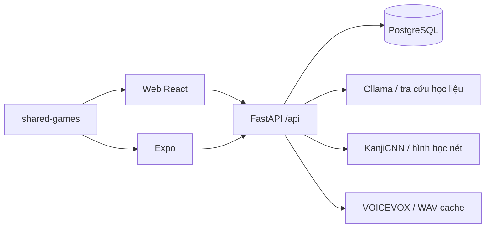

# SenpaiAI — tổng quan dự án và hướng dẫn bảo vệ

Cập nhật từ workspace nhánh `mobile`, ngày 24/11/2026. Tài liệu này thay thế các bản tổng quan, giải thích từng file và hướng dẫn bảo vệ cũ. Mô tả chức năng trong workspace không đồng nghĩa mọi thay đổi mã nguồn đã được commit/phát hành. Xem [mục lục](README.md) để đi vào từng chủ đề.

## Mục tiêu và kiến trúc

SenpaiAI hỗ trợ người Việt học tiếng Nhật theo cấp JLPT: hỏi đáp, thư viện học liệu, ngữ pháp, Kanji, nghe, nhiệm vụ hằng ngày, xếp trình độ và theo dõi lộ trình. Web dùng React/Vite; ứng dụng di động dùng Expo; backend FastAPI xử lý xác thực, nội dung, lịch sử và chấm bài. PostgreSQL lưu dữ liệu nghiệp vụ; Ollama cung cấp LLM local; VOICEVOX tạo âm thanh; KanjiCNN nhận dạng ảnh. Logic chín minigame nằm trong TypeScript dùng chung.



## Bản đồ mã nguồn

| Phần | Điểm bắt đầu và vai trò |
| --- | --- |
| Khởi tạo backend | [main.py](../backend/app/main.py): router, middleware, lifecycle; các bảng phát triển bằng Alembic không được thay bằng `create_all` |
| Dữ liệu và migration | [models](../backend/app/models/database.py), [Alembic](../backend/alembic/versions/): dữ liệu tài khoản, lịch sử, quyền sở hữu và tiến hóa schema |
| Web và xác thực | [App.tsx](../frontend/src/App.tsx), [auth.tsx](../frontend/src/services/auth.tsx), [API client](../frontend/src/services/api.ts) |
| Di động | [mobile/src](../mobile/src/): API client, lưu token, màn hình và các dịch vụ native |
| Chat và tra cứu | [chat.py](../backend/app/api/chat.py), [chat_quality.py](../backend/app/services/chat_quality.py), [chat_knowledge.py](../backend/app/services/chat_knowledge.py) |
| Câu hỏi và nhiệm vụ | [exercise_selection.py](../backend/app/services/exercise_selection.py), [daily_task_service.py](../backend/app/services/daily_task_service.py) |
| Placement | [placement.py](../backend/app/api/placement.py), [placement_scoring.py](../backend/app/services/placement_scoring.py) |
| Lộ trình | [learning_history.py](../backend/app/services/learning_history.py), [learning_progress.py](../backend/app/services/learning_progress.py) |
| Kanji | [kanji.py](../backend/app/api/kanji.py), [kanji_writing.py](../backend/app/api/kanji_writing.py), [KanjiWriting.tsx](../frontend/src/components/kanji/KanjiWriting.tsx) |
| Minigame | [shared-games](../shared-games/), [GameFrame](../frontend/src/components/minigames/GameFrame.tsx) |

## Những luồng cần giải thích được

**Đăng nhập:** client gửi thông tin đăng nhập, backend kiểm tra mật khẩu đã hash và cấp JWT. API lấy tài khoản từ token, không tin `user_id` tự gửi. Mất kết nối chưa phải bằng chứng token hết hạn. Xuất dữ liệu/reset/xóa tài khoản phải giữ đúng phạm vi sở hữu; reset tiến độ không được mở đường nhận lại thưởng Hằng ngày.

**Chọn trình độ:** placement dùng câu có dữ liệu kiểm chứng, kết quả là ước tính học tập. Không tuyên bố vượt phạm vi kho câu hỏi. Việc xác nhận kết quả và thiết lập `current_jlpt_level` phải theo luồng server; không dùng điểm trò chơi để tự nâng JLPT.

**Nhiệm vụ và ngữ pháp:** chọn nội dung qua sổ câu đã phục vụ và dịch vụ dùng chung. Backend chấm đáp án và ghi lịch sử; dữ liệu nguồn, fingerprint và lịch sử giúp chống lặp. Mô tả thuật toán, cooldown và giới hạn ở [Chọn bài tập](DICH_VU_CHON_BAI_TAP.md).

**Lộ trình:** tổng hợp bằng chứng học theo thời gian và độ khó, phân biệt điểm trực tiếp với proxy/tự báo cáo. Mục tiêu tuần, gợi ý và nhận xét tuần/tháng theo luật, không nhờ LLM tự phán năng lực. Xem [Lộ trình](LO_TRINH_VA_TIEN_DO.md).

**Kanji:** nhận dạng ảnh trả các lớp có thể là chữ người viết; chấm nét biết trước chữ đích và so sánh hình học từng nét. Hai bài toán khác nhau, không dùng CNN để quyết định chất lượng thứ tự nét. Xem [nhận dạng](KANJI_RECOGNITION_DIAGNOSIS.md) và [luyện viết](DANH_GIA_NET_KANJI.md).

**Minigame:** engine thuần quản lý state và vòng đời; lớp học tập thêm chiến dịch, XP riêng và sự kiện ôn tập. Điểm ván/XP không phải số dư cửa hàng. Xem [Minigame](MINIGAMES.md).

## Cơ sở dữ liệu và tương thích

Migration mới nối revision hiện có, có downgrade và kiểm tra trạng thái. Downgrade có thể từ chối nếu còn dữ liệu để tránh mất lịch sử. Không chạy reset/xóa/downgrade trên tài khoản thật chỉ để kiểm thử. Mốc workspace hiện có đến revision `0023`; khi triển khai phải kiểm tra head thực tế của bản mã được phát hành.

API cũ giữ hợp đồng; endpoint mới bổ sung cho từng tính năng. Các client có thể nhận thêm trường nhưng không được dựa vào ID hoặc điểm do người dùng tự khai để cấp thưởng. i18n vi/en dùng chung, theme sáng/tối và giảm chuyển động là yêu cầu xuyên suốt.

## Chạy và kiểm tra

Cài đặt đầy đủ ở [README dự án](../README.md). Từ thư mục `backend`, dùng môi trường Python đã cài dependency và chạy Uvicorn trên `0.0.0.0:8000` nếu điện thoại thật cần truy cập. `mobile/.env` dùng `EXPO_PUBLIC_API_URL=http://IP-LAN:8000/api`; cùng IP phải có trong `ALLOWED_HOSTS` của backend. Sau khi đổi cấu hình, nạp lại backend và Expo. `400 Invalid host header` khác với không có kết nối TCP; `/health` trên máy tính thành công chưa chứng minh điện thoại cùng mạng truy cập được.

Các lệnh kiểm tra thường dùng:

```powershell
# backend
.\venv\Scripts\python.exe -m pytest -q
# frontend
node --test tests/*.test.mjs
npm.cmd run i18n:check
npm.cmd run build
# mobile
npm.cmd run typecheck
npm.cmd run i18n:check
npm.cmd run backend:check
```

Mốc mã gần nhất trước dọn tài liệu: 321 pytest + 6 subtest và 79 test web đạt; build, TypeScript, lint phần sửa và khóa dịch đạt. Đây là số đo có thời điểm, không phải lời cam kết mọi môi trường hay thiết bị thật đều đã được nghiệm thu.

## Dàn ý bảo vệ

1. Giới thiệu đối tượng học và vấn đề cần giải quyết; demo một luồng học trọn vẹn thay vì chỉ liệt kê trang.
2. Chỉ ra ranh giới web/mobile/backend và nơi dữ liệu thật được lưu.
3. Phân biệt phần tự huấn luyện, mô hình có sẵn và luật — xem [Kiến trúc AI](BAO_CAO_AI_SENPAIAI.md).
4. Giải thích vì sao dùng lịch sử câu hỏi, hình học nét và báo cáo theo luật; nêu một ca lỗi đã tái hiện và cách kiểm chứng.
5. Trình bày benchmark đúng phạm vi: font render/mô phỏng không phải viết tay thật; rubric Chat không phải giám khảo tiếng Nhật.
6. Demo quyền riêng tư, xử lý lỗi mạng và giới hạn dữ liệu; không dùng tài khoản thật để minh họa xóa/reset.

Các bảng rà soát [Kanji N3](kanji_n3_review.md) và [học liệu thư viện](library_documents_review.md) được giữ để người biết tiếng Nhật kiểm tra nội dung, không coi dữ liệu soạn sẵn là đã được giáo viên duyệt.
