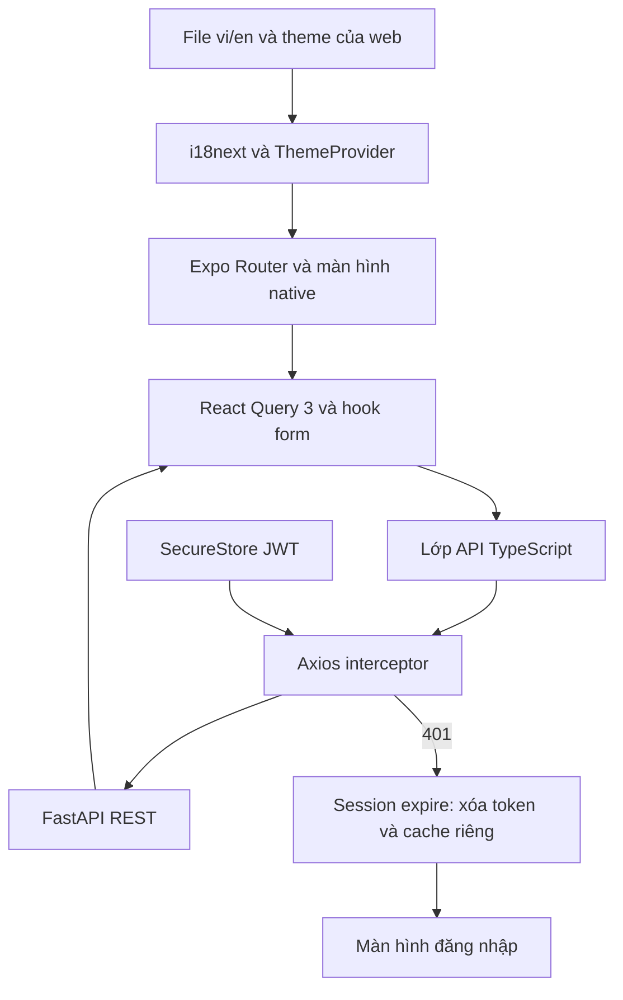

# Kiến trúc SenpaiAI Mobile

Phiên bản dự án 0.3.0, nhánh `mobile`. Ứng dụng Expo/React Native viết bằng TypeScript, tách khỏi React/Vite web. Backend FastAPI không thay đổi trong Giai đoạn 3.

## Cấu trúc thư mục

| Thư mục | Trách nhiệm |
| --- | --- |
| `app/` | Route theo tệp Expo Router; nhóm xác thực, năm tab, route bài làm/chi tiết |
| `src/screens/` | Giao diện React Native; FlatList cho danh sách, trạng thái tải/rỗng/lỗi |
| `src/components/` | Điều khiển dùng lại, skeleton, mạng, xác nhận nguy hiểm, đồ họa nét |
| `src/components/questions/` | QuestionCard dùng chung cho Hằng ngày và Ngữ pháp |
| `src/api/` | Axios, hợp đồng dữ liệu và lớp dịch vụ Giai đoạn 0–3 |
| `src/auth/`, `storage/` | Máy trạng thái phiên và token trong SecureStore |
| `src/features/` | Logic thuần: tiếp tục nhiệm vụ, gửi đáp án, fallback AI, lọc/phân trang, chấm quiz, hình học vector |
| `src/i18n/` | Một instance i18next; nhập trực tiếp namespace web và locale bổ sung mobile |
| `src/theme/` | Mode sáng/tối/hệ thống và palette lấy trực tiếp từ web |
| `assets/` | Biểu tượng PNG 1024, thiết kế SVG gốc; không dùng ảnh tải từ dịch vụ ngoài |
| `scripts/`, `tests/` | Kiểm tra hợp đồng, khóa dịch, bundle, kiểu, logic và tích hợp API |
| `docs/` | Kiến trúc, màn hình, chẩn đoán AI và checklist demo |

## Luồng dữ liệu

Request đọc dùng React Query, phân biệt key theo người dùng/ngôn ngữ/bộ lọc. Các mutation không tự retry. Đăng nhập/khôi phục có generation guard để response cũ không phục hồi phiên đã đăng xuất. Token không lưu trong AsyncStorage, log hoặc mã bundle.

## Dùng chung với web

`src/i18n/resources.ts` nhập trực tiếp `frontend/src/i18n/locales/{vi,en}/*.json`; `metro.config.js` theo dõi thư mục ngoài `mobile/`. Không chép file dịch. Nhãn riêng cho mobile ở `src/i18n/locales/vi.json` và `en.json`, cùng instance i18next. Kiểm tra xác nhận khóa và placeholder tương ứng; kiểm tra AST phát hiện nhãn JSX tĩnh chưa dịch, cho phép tên sản phẩm/giấy phép.

Theme nhập `frontend/src/themes/themes.ts`, hỗ trợ Classic, Than Khe, Sakura ở sáng/tối/hệ thống. `AccountThemeBridge` chỉ áp dụng theme mà phản hồi server xác nhận đang dùng và thuộc danh sách đã mở khóa; đăng xuất trở về Classic. Cửa hàng gửi `/rewards/equip` sau khi đọc lại quyền, không tự suy đoán quyền từ số điểm. Không có mua trong bản rút gọn.

Không nhập JSX/Tailwind, browser localStorage, navigator.clipboard hoặc DOM web vào React Native. Bộ kiểm tra email/username/password tương đương web được xác minh bằng test. Mục tiêu JLPT lưu thành chuỗi `JLPT N3` trong `learning_goals`, không bịa thêm trường API `target_jlpt_level` và không tự đổi `current_jlpt_level` khi đặt mục tiêu.

## Các quyết định quan trọng

- **Hằng ngày:** ngày và lịch sử từ server; đồng hồ trả lời dùng `performance.now()`. Điểm do server trả. Mất phản hồi đọc lại trạng thái trước khi thử gửi; không hứa exactly-once khi backend chưa có idempotency key.
- **Ngữ pháp:** nguồn AI/mixed lỗi thì chọn lại bank; giữ phiên/kết quả cũ. Backend chưa đọc lại được từng attempt theo phiên nên khóa gửi lại khi không rõ đáp án đã lưu.
- **Kanji:** cùng API dictionary và quiz của web. Phân trang offset, tìm sau 300 ms. API quiz trả đáp án và không có chấm server, nên là bài tự luyện tại máy, không nhận điểm tài khoản.
- **Nét viết:** API trả đường SVG KanjiVG. Bộ phân tích thuần TypeScript hỗ trợ các lệnh thực tế M/m, C/c, S/s (và L/l), lấy mẫu đường Bézier thành đoạn vector và dựng bằng View/Animated. Không thêm SVG/WebView/Skia native. Đây là xấp xỉ hình học để trình diễn thứ tự nét, không phải trình dựng SVG tổng quát; lệnh không hỗ trợ được báo thay vì vẽ sai. Test duyệt toàn bộ path KanjiVG đã lưu trong dự án.
- **Chat:** lớp dữ liệu tách riêng, tin nhắn đảo chiều và phân trang; lọc nguồn quy tắc nội bộ. Voice chỉ xem nếu có ID; API danh sách vẫn chỉ liệt kê text.
- **Kết nối:** health check 15 giây khi app hoạt động, lỗi có thông báo, phục hồi thì refetch query; không retry mutation. Khôi phục phiên offline có giới hạn tần suất.
- **Tài khoản:** xuất JSON qua chọn/copy và Share của hệ điều hành, không thêm mô-đun ghi tệp. Reset/delete yêu cầu đọc cảnh báo và gõ từ xác nhận. Reset tuân thủ phần dữ liệu server thực sự xóa; giữ phần điểm/nhiệm vụ mà server bảo tồn.

## Ranh giới và giới hạn

SecureStore bảo vệ JWT; dữ liệu API vẫn cần backend thực thi quyền. Mobile không cấp quyền sửa/xóa Thư viện khi API thiếu owner/permission metadata. Chưa có ghi âm, vẽ tay, nghe, push, mua giao diện, trò chơi hoặc chế độ offline hoàn chỉnh.

Biểu tượng và background native được khai báo bằng Expo config; màn hình chờ React có thương hiệu và chạy với cả sáng/tối. Không thêm `expo-splash-screen` theo ràng buộc không thêm thư viện native: giai đoạn trước khi JavaScript chạy giữ hành vi splash mặc định của Expo/hệ điều hành. Muốn điều khiển launch screen native đầy đủ cần công việc riêng.

Xuất bundle Android/iOS xác minh Metro và Hermes, không thay thế kiểm thử trên điện thoại. SDK 58 cần Expo Go tương thích; không thể hứa chạy trực tiếp bằng Expo Go SDK 54 từ App Store. Xem [DEMO_CHECKLIST.md](DEMO_CHECKLIST.md) để chuẩn bị đúng bản Go hoặc bản cài đặt phù hợp.
